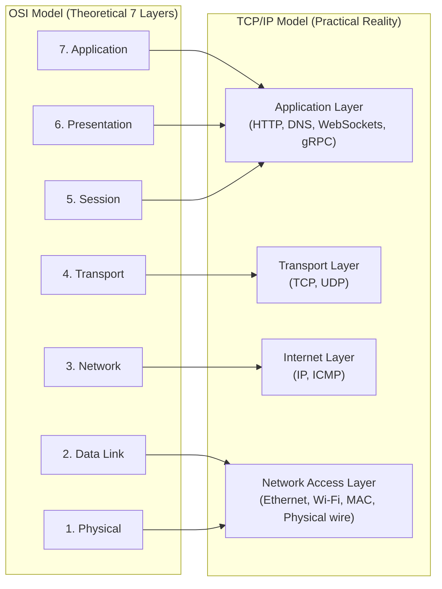
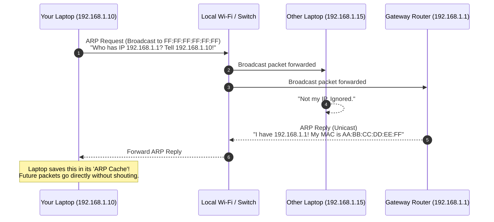
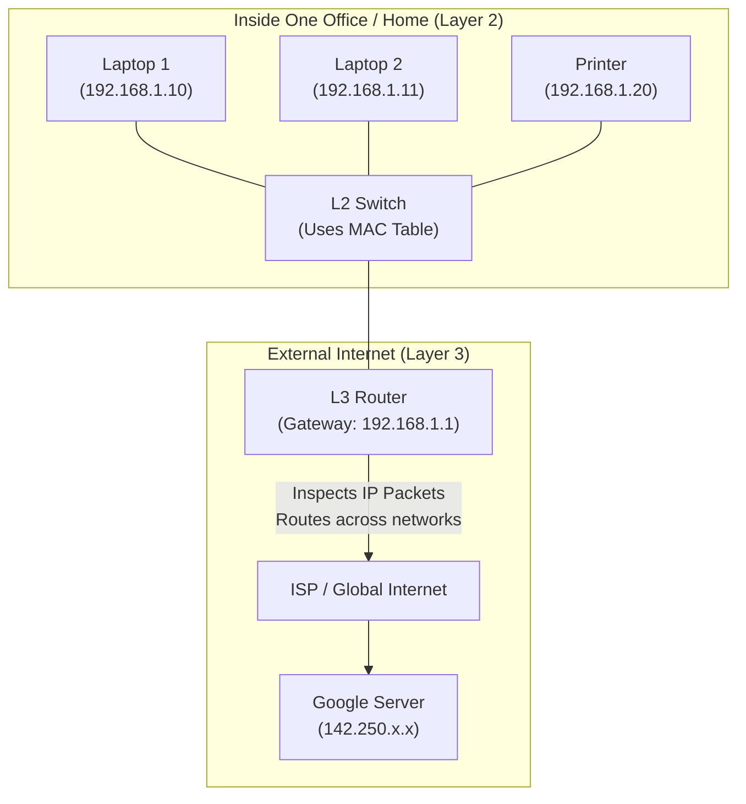
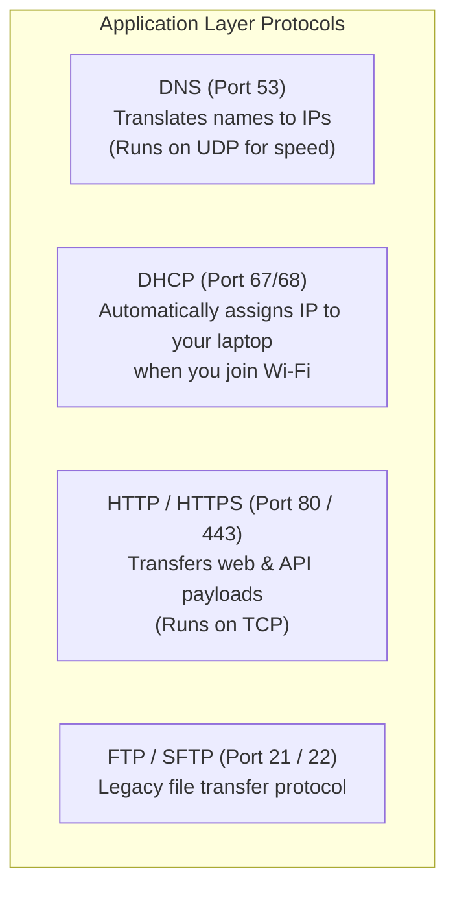
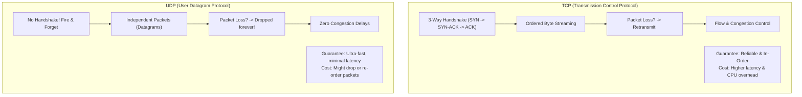
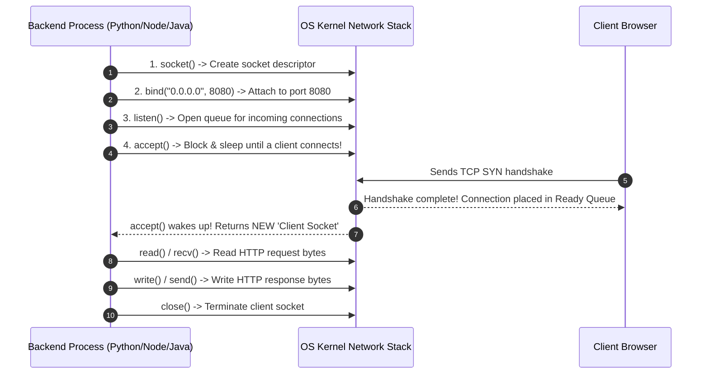

# Computer Networks SDE Roadmap & Top 20 Interview Masterclass

**Target Audience:** SDE-1 / SDE-2 candidates preparing for **₹20+ LPA roles** in India.  
**Philosophy:** No dry textbook definitions. Every concept is explained in plain conversational English with real-life analogies, visual flowcharts, and direct connections to **System Design and Backend Production Engineering**.

---

## 🗺️ Part 1: The Core Computer Networks Roadmap

This maps directly to the official SDE curriculum:
1. [OSI Model vs. TCP/IP Model (Why both exist)](#1-osi-model-vs-tcpip-model)
2. [MAC Address & ARP: How Packets Move on the Local Wire](#2-mac-address--arp-address-resolution-protocol)
3. [Routers vs. Switches (L2 vs. L3 Explained Simply)](#3-routing--switching-routers-vs-switches)
4. [IP Addressing, Subnetting & CIDR Notation](#4-ip-addressing-subnetting--cidr-demystified)
5. [Core Protocols: DNS, DHCP, HTTP/HTTPS, FTP](#5-core-protocols-dns-dhcp-httphttps-ftp)
6. [TCP vs. UDP: Mechanics & System Design Trade-offs](#6-tcp-vs-udp-deep-dive)
7. [Socket Programming Basics (The Bridge to Backend Code)](#7-socket-programming-basics)

---

## 🎯 Part 2: Top 20 Most Asked Networking Questions (₹20+ LPA Interview Q&A)

Jump directly to the [Top 20 Most Asked Questions](#top-20-most-asked-networking-interview-questions).

---

# Part 1: The Core Computer Networks Roadmap

---

## 1. OSI Model vs. TCP/IP Model

### Why Do We Have Two Models?
- **OSI Model (7 Layers):** Created by committee as a theoretical teaching standard. Nobody implemented it directly in hardware/software.
- **TCP/IP Model (4/5 Layers):** Created by engineers who actually built the internet. It is the practical model that runs on your operating system and network cards.



### The "Russian Matryoshka Doll" Analogy (Encapsulation)
When your React frontend calls `fetch('/orders')`, data doesn't just teleport:
1. **Application Layer:** Creates the HTTP string: `GET /orders`.
2. **Transport Layer (TCP):** Wraps it in a TCP segment with Source Port (`54321`) & Destination Port (`443`).
3. **Network Layer (IP):** Wraps that inside an IP packet with Source IP (`192.168.1.10`) & Destination IP (`142.250.180.46`).
4. **Data Link Layer (Ethernet/Wi-Fi):** Wraps that inside an Ethernet Frame with your laptop's **MAC Address** and your Wi-Fi router's **MAC Address**.
5. **Physical Layer:** Converts the frame into radio waves (Wi-Fi) or light pulses (fiber).

---

## 2. MAC Address & ARP (Address Resolution Protocol)

### The Problem
You have Google's IP address (`142.250.180.46`). But your laptop cannot talk to Google directly across the planet—it can only transmit an electrical signal to your **local home Wi-Fi router** sitting 5 meters away.
How does your laptop deliver a packet to the router on the local wire?

### IP Address vs. MAC Address

| Property | IP Address (Network Layer - L3) | MAC Address (Data Link Layer - L2) |
|---|---|---|
| **What it is** | Logical Address (where you are currently located) | Physical Address (who you physically are) |
| **Real-life analogy** | Your current postal mailing address (Room 402, Bangalore) | Your Aadhaar / National ID Card Number (Permanently burnt into you) |
| **Changes?** | Yes! Changes when you move from home Wi-Fi to a coffee shop. | No. Permanently etched into your Network Interface Card (NIC). |

---

### How ARP Works (The Office Shout Analogy)

When your laptop wants to send data to your router (`192.168.1.1`), it doesn't know the router's physical MAC address.



> 💡 **Try it in PowerShell right now:**  
> Run `arp -a` in your terminal. You will see a table mapping local IP addresses to their physical MAC addresses!

---

## 3. Routing & Switching (Routers vs. Switches)

In interviews, you might be asked: *"What is the difference between a Layer 2 Switch and a Layer 3 Router?"*



| Device | Operating Layer | Primary Identifier Used | Responsibility |
|---|---|---|---|
| **L2 Switch** | **Layer 2 (Data Link)** | **MAC Address** | Connects devices **within the same local network**. Inspects MAC frames and forwards them directly to the target port. |
| **L3 Router** | **Layer 3 (Network)** | **IP Address** | Connects **different networks together** (e.g., your home network to the global internet). Reads destination IP addresses and finds the best path through internet routers. |

---

## 4. IP Addressing, Subnetting & CIDR Demystified

### What is an IP Address?
An IPv4 address is simply a **32-bit binary number** written as 4 numbers separated by dots:
`192.168.1.1` $\to$ each number is an 8-bit byte (0 to 255).

Every IP address contains two parts:
1. **Network Prefix:** Identifies which network you belong to (like a ZIP/PIN code).
2. **Host Identifier:** Identifies your specific machine inside that network (like your flat number).

---

### CIDR Notation (e.g., `10.0.0.0/24`)

In AWS or Kubernetes configs, you always see `/16` or `/24`. What does the slash mean?
- The number after the slash tells you **how many bits are reserved for the Network ID**.

```
Total bits in IPv4 = 32 bits

Example 1: 192.168.1.0/24
- Network bits = 24 bits
- Remaining bits for devices (hosts) = 32 - 24 = 8 bits
- Number of usable IPs = 2^8 = 256 IPs (minus 2 reserved = 254 devices)

Example 2: 10.0.0.0/16 (Standard AWS VPC)
- Network bits = 16 bits
- Remaining bits for devices = 32 - 16 = 16 bits
- Number of usable IPs = 2^16 = 65,536 IPs!
```

> 🎯 **Rule of Thumb for Interviews:**  
> Smaller slash number (`/16`) = **Huge network** (many hosts).  
> Larger slash number (`/28`) = **Tiny network** (few hosts).

---

## 5. Core Protocols: DNS, DHCP, HTTP/HTTPS, FTP



### What is DHCP (The Hotel Check-In Desk Analogy)?
When you open your laptop in a coffee shop, you don't manually type an IP address or subnet mask.  
Your laptop sends a **DHCP Discover broadcast**:
1. **Discover:** Laptop shouts: *"Hey, I just connected! Can someone give me an IP?"*
2. **Offer:** The router answers: *"You can have `192.168.1.55` for the next 24 hours."*
3. **Request:** Laptop: *"Great, I accept `192.168.1.55`."*
4. **Acknowledge:** Router: *"Confirmed. Here is your Subnet Mask, Gateway IP, and DNS IP."*

---

## 6. TCP vs. UDP Deep Dive



### Where Backend Engineers Choose TCP vs. UDP:
- **Use TCP for:** Web APIs (REST, GraphQL), Database connections (Postgres, Mongo), File transfers, Financial transactions where **zero data loss is permitted**.
- **Use UDP for:** Video streaming (Zoom, WebRTC), Multiplayer gaming (player movement coordinates), DNS queries, Metric logging (StatsD), and modern **HTTP/3 (QUIC)**.

---

## 7. Socket Programming Basics

A **Socket** is simply an operating system abstraction representing an endpoint of a two-way network connection.  
To your operating system (Linux/Windows), a socket is treated just like an **open file descriptor** that you can read bytes from and write bytes to.

```
Socket Address = IP Address + Port Number
Example: 192.168.1.10 : 8080
```

### The Life of a Server Socket (Visual Sequence):



---

# Part 2: Top 20 Most Asked Networking Interview Questions

---

### Q1: What happens when you type `https://google.com` into your browser and press Enter?
> **Interview Answer:**  
> "First, the browser checks its local cache and queries the **DNS resolver** to translate `google.com` into an IP address. Once resolved, the browser initiates a **TCP 3-way handshake** (SYN, SYN-ACK, ACK) with the server on port 443. Next, a **TLS handshake** occurs: the server presents its SSL certificate, the browser verifies it against its trusted Certificate Authorities, and both sides negotiate a symmetric session key. The browser then sends an encrypted **HTTP GET request**. The server's reverse proxy or load balancer routes the request to an application instance, which processes it and returns an **HTTP 200 response**. Finally, the browser parses the HTML, fetches referenced CSS/JS assets, and renders the page."

---

### Q2: What is the difference between TCP and UDP, and when would you use each?
> **Interview Answer:**  
> "TCP is a connection-oriented, reliable protocol that guarantees in-order delivery of bytes through acknowledgments, sequence numbers, and retransmissions, along with congestion control. It has handshake overhead and latency penalties. UDP is connectionless and lightweight—it sends datagrams without handshakes, ordering guarantees, or retransmissions. I use TCP for mission-critical systems like REST APIs, database queries, and payment processing where no data loss is tolerated. I use UDP for real-time systems like live audio/video streaming, gaming coordinate updates, and DNS lookups where speed matters more than occasional lost packets."

---

### Q3: What is the TCP 3-Way Handshake and why can't it be a 2-way handshake?
> **Interview Answer:**  
> "The 3-way handshake establishes a reliable TCP connection:
> 1. Client sends **SYN** with an Initial Sequence Number (ISN_C).
> 2. Server responds with **SYN-ACK**, acknowledging ISN_C and sending its own ISN_S.
> 3. Client replies with **ACK**, confirming ISN_S.
> 
> A 2-way handshake is insufficient because both sides must independently synchronize and acknowledge each other's initial sequence numbers. In a 2-way handshake, the server would never know if the client received its sequence number, making it vulnerable to duplicate delayed packets opening half-open ghost connections on the server."

```
Client               Server
  │                    │
  │─── SYN (seq=X) ───►│
  │                    │
  │◄── SYN-ACK ────────│  (ack=X+1, seq=Y)
  │                    │
  │─── ACK (ack=Y+1) ─►│
  ▼                    ▼
  [Connection ESTABLISHED]
```

---

### Q4: What is the difference between a MAC Address and an IP Address?
> **Interview Answer:**  
> "A MAC address is a physical, 48-bit hardware identifier permanently assigned to a Network Interface Card (NIC) at Layer 2, used for delivering frames between physically connected devices on the same local subnet. An IP address is a logical, 32-bit (IPv4) or 128-bit (IPv6) address operating at Layer 3, used to route packets across disparate networks across the global internet. You can think of an IP address as your postal mailing address which changes when you travel, while your MAC address is like your national ID card number which stays with you permanently."

---

### Q5: What is ARP and how does it resolve IP addresses to MAC addresses?
> **Interview Answer:**  
> "ARP (Address Resolution Protocol) bridges Layer 3 and Layer 2. When a machine needs to deliver a packet to a local IP on its subnet, it broadcasts an **ARP Request** frame to the broadcast MAC address `FF:FF:FF:FF:FF:FF` asking: *'Who owns this IP? Send your MAC address to me.'* All machines on the local network receive the broadcast, but only the machine owning that IP responds with a unicast **ARP Reply** containing its MAC address. The requester caches this in its local ARP table for future communication."

---

### Q6: What is the difference between an L4 and an L7 Load Balancer?
> **Interview Answer:**  
> "An **L4 Load Balancer** operates at the transport layer (TCP/UDP), routing packets purely based on source/destination IP addresses and ports without decrypting TLS or parsing application data. It is extremely fast with low CPU overhead (e.g., AWS NLB). An **L7 Load Balancer** operates at the application layer, terminating TLS and inspecting HTTP headers, cookies, and URL paths. This allows intelligent routing (such as sending `/orders` to the Order Service and `/users` to the User Service) and cookie-based sticky sessions, at the cost of higher CPU and memory overhead (e.g., AWS ALB or Nginx)."

---

### Q7: What is the difference between HTTP/1.1, HTTP/2, and HTTP/3?
> **Interview Answer:**  
> "HTTP/1.1 processes requests sequentially per TCP connection, suffering from application-level head-of-line blocking and requiring browsers to open up to 6 parallel TCP connections per domain. HTTP/2 introduced binary multiplexed streams over a single TCP connection along with HPACK header compression, eliminating application-level blocking. However, HTTP/2 still suffers from transport-level head-of-line blocking because a single lost TCP packet stalls all streams. HTTP/3 completely solves this by replacing TCP with **QUIC over UDP**, making each stream truly independent at the transport layer and enabling 0-RTT connection resumption for mobile clients."

---

### Q8: What is DNS, and what happens during recursive vs. iterative DNS queries?
> **Interview Answer:**  
> "DNS translates human-readable domain names into machine IP addresses. In a **recursive query**, the client asks the local DNS resolver (e.g., your ISP or `8.8.8.8`) to do all the work and return the final IP address or an error. In an **iterative query**, the resolver queries the DNS hierarchy step-by-step: first querying the **Root DNS Server** (which refers it to the `.com` TLD server), then querying the **TLD Server** (which refers it to the domain's Authoritative Name Server), and finally querying the **Authoritative Server**, which returns the actual `A` record."

---

### Q9: What is NAT (Network Address Translation) and why is it essential?
> **Interview Answer:**  
> "NAT allows multiple devices on a private local network (using non-routable private IPs like `192.168.x.x` or `10.x.x.x`) to share a single public IP address to access the internet. The router maintains a NAT translation table mapping private IP and source port combinations to external public ports. NAT solved the immediate exhaustion of IPv4 addresses and provides basic inbound security by preventing unauthorized external machines from directly addressing internal computers. In cloud infrastructure like AWS, private subnets use NAT Gateways to access external internet APIs while remaining shielded from direct inbound internet traffic."

---

### Q10: What does the CIDR notation `/24` mean in an IP address like `192.168.1.0/24`?
> **Interview Answer:**  
> "In CIDR notation, the number after the slash represents the prefix length—the number of bits allocated to the Network ID out of 32 total IPv4 bits. A `/24` means the first 24 bits represent the network, leaving 8 bits (`32 - 24 = 8`) for host machines. This allows for $2^8 = 256$ total IP addresses, of which 254 are usable for devices (since the network address `.0` and broadcast address `.255` are reserved). A `/16` network conversely leaves 16 bits for hosts, supporting 65,536 IP addresses."

---

### Q11: What is the difference between `Connection: keep-alive` and WebSockets?
> **Interview Answer:**  
> "`Connection: keep-alive` is an HTTP feature that keeps the underlying TCP connection open across multiple sequential HTTP request/response pairs, avoiding the latency of repeated handshakes; however, communication remains strictly unidirectional where the client must initiate every request. A **WebSocket** starts as an HTTP connection and upgrades via `101 Switching Protocols` to a persistent, full-duplex TCP channel where both client and server can send messages to each other at any time with minimal frame overhead, making it suitable for real-time bidirectional apps like chat and live collaboration."

---

### Q12: What is the difference between a Reverse Proxy and a Forward Proxy?
> **Interview Answer:**  
> "A forward proxy sits in front of clients to regulate, filter, or anonymize their outbound internet requests (e.g., corporate web proxies or VPNs). The server only sees the proxy's IP, not the client's. A reverse proxy sits in front of backend servers to protect and optimize them. It handles incoming public requests, terminates TLS, caches static assets, buffers slow clients, and distributes traffic to private backend microservices. The client only sees the reverse proxy's IP, never the private IPs of the application servers."

---

### Q13: What causes a "Connection Refused" error versus a "Connection Timed Out" error?
> **Interview Answer:**  
> "A **Connection Refused** error is fast because the client's TCP SYN reached the target host, but the operating system kernel immediately sent back a TCP RST (Reset) packet indicating that no application is listening on that port (meaning the app crashed or the port was wrong). A **Connection Timed Out** error is slow (typically 30–60 seconds) because the client received no response at all; the SYN packets were silently dropped by a firewall, an AWS Security Group, or a routing black hole."

---

### Q14: What is Head-of-Line (HoL) Blocking and where does it occur?
> **Interview Answer:**  
> "Head-of-Line blocking occurs when a single slow or stalled packet at the front of a queue blocks all subsequent packets from being processed:
> 1. **In HTTP/1.1:** It happens at the application layer because each TCP connection can only handle one request at a time.
> 2. **In HTTP/2:** Application HoL is fixed via stream multiplexing, but it still exists at the transport layer: because all streams share one TCP connection, a single dropped TCP packet stalls all multiplexed streams until retransmitted.
> 3. **In HTTP/3:** It is eliminated entirely at the transport layer by using QUIC over UDP, ensuring each stream retransmits independently."

---

### Q15: Why is Database Connection Pooling mandatory in production backend systems?
> **Interview Answer:**  
> "Establishing a database connection is expensive: it requires a TCP handshake, TLS negotiation, authentication, and memory allocation for backend server processes (consuming 5–10MB of RAM per connection in Postgres). Without pooling, high concurrency exhausts server RAM and causes high connection latency. Connection pools like HikariCP maintain pre-warmed open connections. Furthermore, pool sizes should be kept small—following the formula `(CPU Cores * 2) + Disk Spindles`—to prevent CPU core thrashing caused by excessive thread context switching."

---

### Q16: What is MTU (Maximum Transmission Unit) and what happens if a packet exceeds it?
> **Interview Answer:**  
> "MTU is the maximum size (in bytes) of a single packet or frame that can be transmitted across a physical network layer without fragmentation. The standard Ethernet MTU is **1500 bytes**. If an IP packet exceeds the MTU of an intermediate router, it must either be fragmented into multiple smaller packets (which adds overhead and CPU strain) or, if the 'Don't Fragment' (DF) flag is set in the IP header, the router drops the packet and returns an ICMP 'Fragmentation Needed' message, which is how Path MTU Discovery (PMTUD) works."

---

### Q17: What is the difference between Symmetric and Asymmetric Encryption in HTTPS?
> **Interview Answer:**  
> "Symmetric encryption uses a single shared secret key to both encrypt and decrypt data; it is extremely fast and computationally efficient, but sharing the secret key across the open internet is unsafe. Asymmetric encryption uses a mathematically linked key pair: a public key to encrypt and a private key to decrypt; it is secure for key exchange but computationally slow. HTTPS uses a hybrid approach: asymmetric encryption (via RSA or Diffie-Hellman) is used during the TLS handshake to authenticate the server and safely exchange a temporary symmetric key, and fast symmetric encryption (like AES-GCM) is used to encrypt all actual web traffic."

---

### Q18: What is a SYN Flood attack and how do SYN Cookies defend against it?
> **Interview Answer:**  
> "A SYN Flood is a Denial-of-Service attack where an attacker sends a massive flood of TCP SYN packets with spoofed source IPs and never responds to the server's SYN-ACKs. The server allocates memory in its connection backlog table for each half-open connection until memory is exhausted and legitimate users are rejected. **SYN Cookies** defend against this by removing the need to store state in memory: the server encodes the connection's state, timestamp, and MSS directly into the 32-bit sequence number of its SYN-ACK response. Only when the client sends back the final ACK does the server verify the mathematical cookie and allocate memory for the connection."

---

### Q19: What is the difference between Anycast and Unicast routing?
> **Interview Answer:**  
> "In **Unicast**, each IP address is tied to a single unique physical machine or interface on the network. In **Anycast**, multiple physical servers located across different geographical regions share the exact same IP address. Internet routers using BGP (Border Gateway Protocol) automatically route a client's packet along the shortest physical network path to the nearest edge location. Anycast is the foundation of CDNs like Cloudflare and global DNS resolvers like Google's `8.8.8.8` to minimize latency and absorb DDoS attacks."

---

### Q20: What are the TIME_WAIT and CLOSE_WAIT TCP states, and what does a spike in them mean?
> **Interview Answer:**  
> "- **`TIME_WAIT`** occurs on the side that initiates the connection close (usually the client or reverse proxy). It holds the socket open for $2 \times \text{MSL}$ (Maximum Segment Lifetime, usually 60–120 seconds) to ensure lingering duplicate packets in the network expire and that the final ACK was received. A spike in `TIME_WAIT` sockets indicates that your application is repeatedly opening and closing short-lived TCP connections rather than reusing connections via HTTP keep-alive or connection pooling.
> - **`CLOSE_WAIT`** occurs on the passive close side when the remote end has closed its connection, but the local application has not yet closed its socket descriptor. A persistent spike in `CLOSE_WAIT` sockets indicates an **application bug / socket leak** where your code forgot to call `.close()` on a failed connection."

---

## 📚 Complete Networking Study Suite Summary

| Guide Name | Topics Covered |
|---|---|
| 📄 [`DAY1_INTERVIEW_GUIDE.md`](./DAY1_INTERVIEW_GUIDE.md) | OSI 7 Layers, TCP/UDP, DNS Resolution, IP & Ports, HTTP, Latency vs Bandwidth, End-to-End URL flow |
| 📄 [`DAY2_INTERVIEW_GUIDE.md`](./DAY2_INTERVIEW_GUIDE.md) | HTTP/2 Multiplexing, WebSockets, REST API Design, CORS, JWT vs Sessions, HTTP Caching |
| 📄 [`DAY3_INTERVIEW_GUIDE.md`](./DAY3_INTERVIEW_GUIDE.md) | Reverse Proxies, L4 vs L7 Load Balancing, API Gateways, gRPC vs REST, Database Connection Pools, Kafka vs RabbitMQ |
| 📄 [`DAY4_5_INTERVIEW_GUIDE.md`](./DAY4_5_INTERVIEW_GUIDE.md) | Plain-English HTTPS/TLS, NAT Gateways, CDNs & Edge Caching, Socket Event Loops (`epoll`), Production Debugging Playbook |
| 📄 [`DAY6_7_INTERVIEW_GUIDE.md`](./DAY6_7_INTERVIEW_GUIDE.md) | HTTP/3 QUIC, Real-Time Decision Matrix (SSE/WS/Webhooks), Rate Limiting, TinyURL & WhatsApp System Design |
| 📄 [`COMPUTER_NETWORKS_ROADMAP_AND_TOP_20_QA.md`](./COMPUTER_NETWORKS_ROADMAP_AND_TOP_20_QA.md) | **[THIS FILE]** SDE Roadmap syllabus (ARP, MAC, Subnetting, Routing/Switching, Sockets) + **Top 20 Interview Masterclass** |

> 🚀 **How to review in VS Code:** Open this file and press `Ctrl + Shift + V` to view rendered tables and diagrams!
