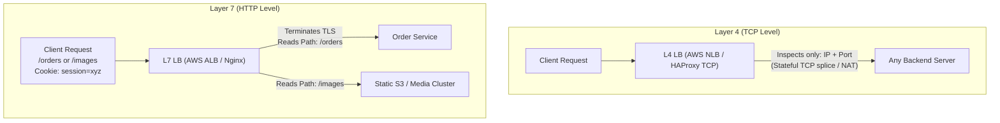
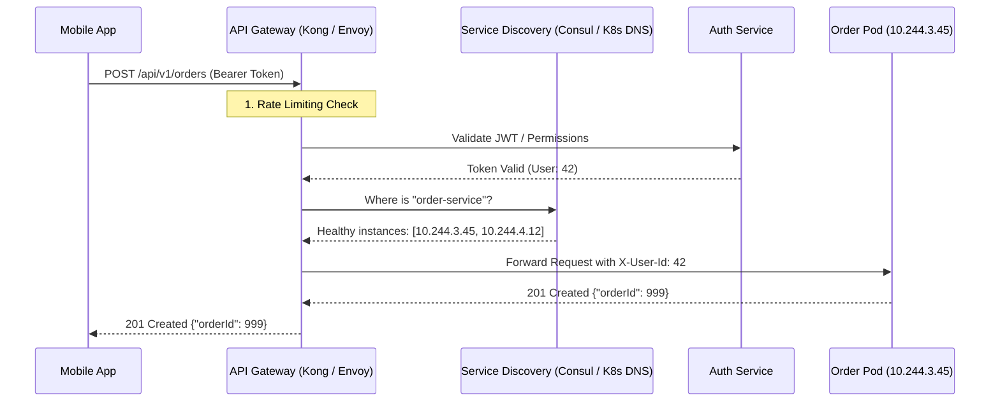
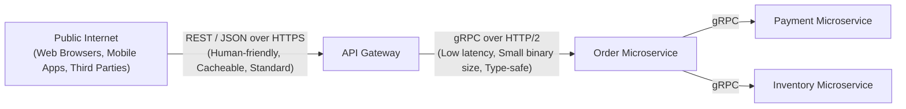
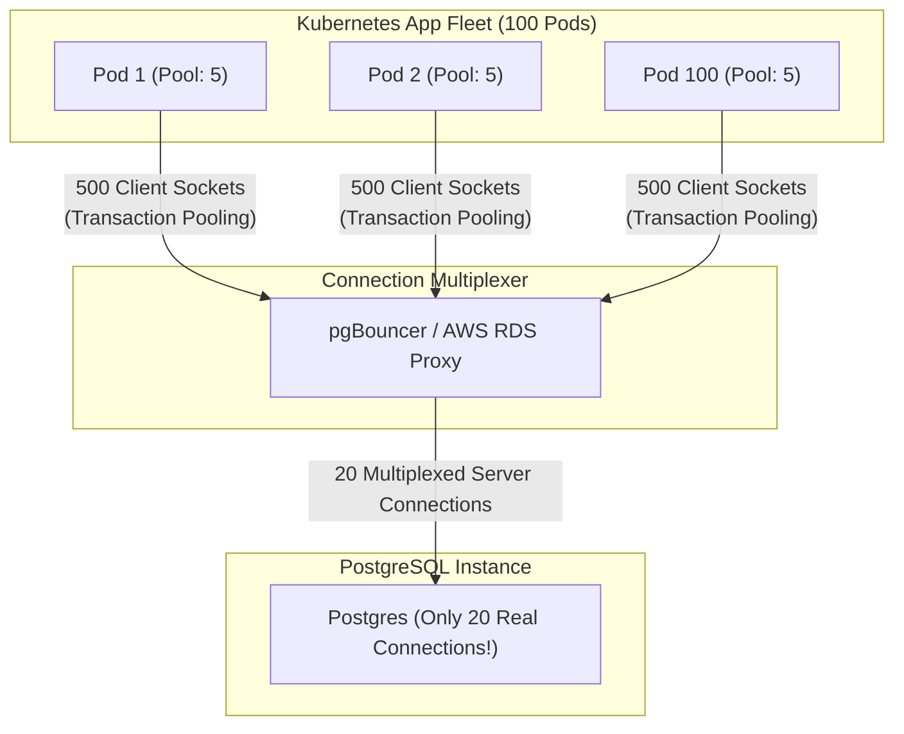
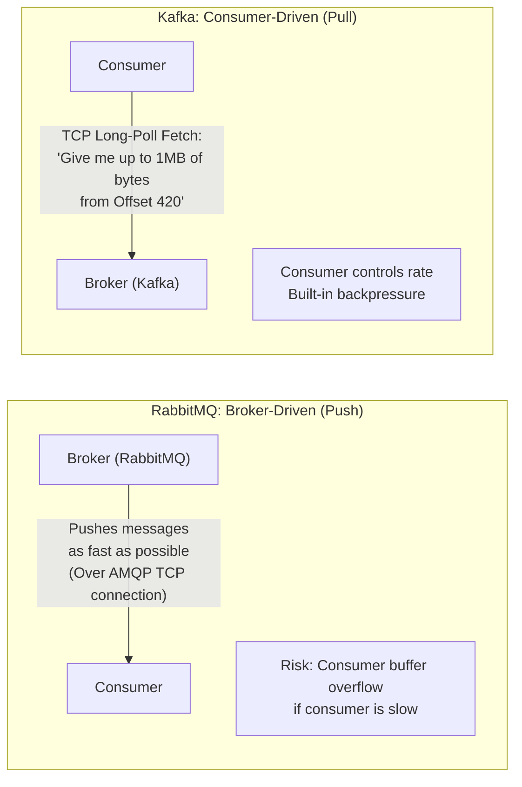
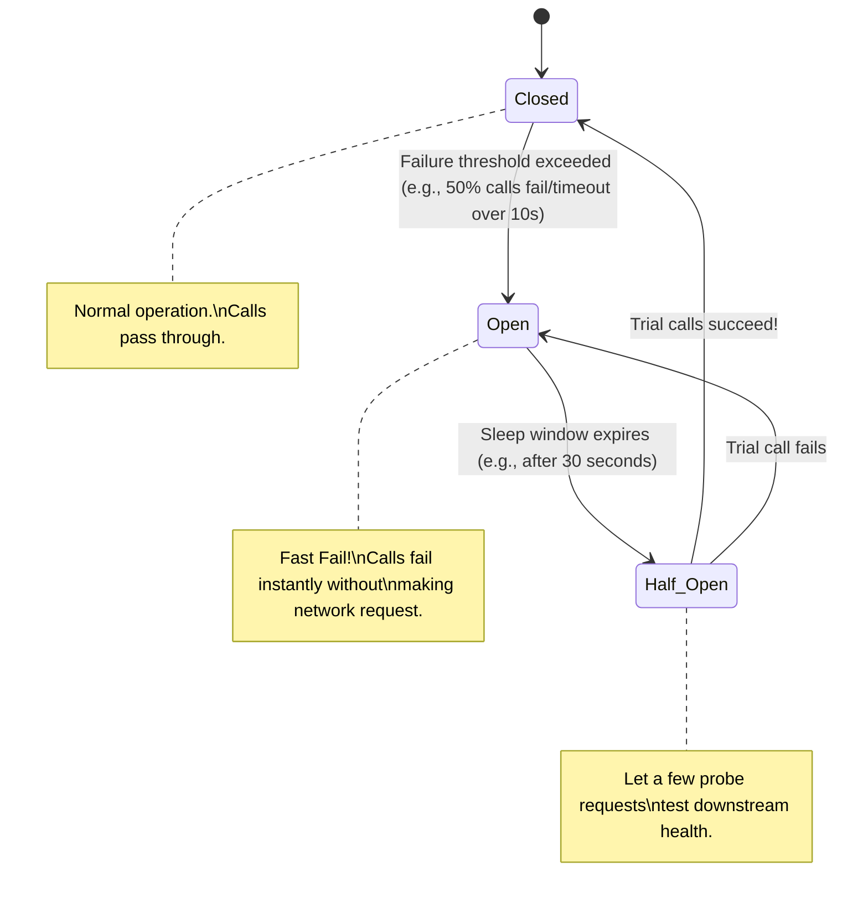
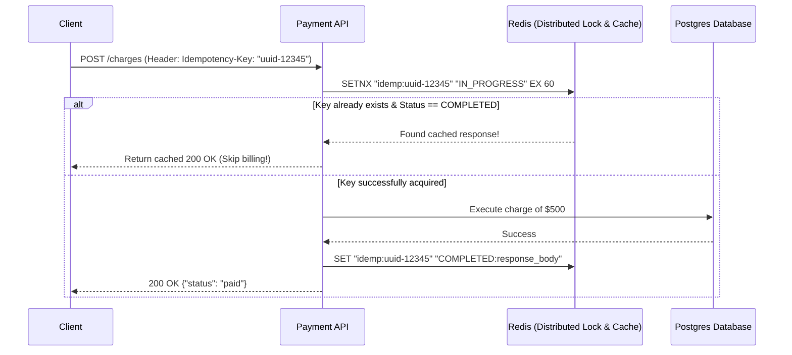

# Day 3 Networking — System Design & Backend Infrastructure Guide

**For:** Software Development Engineers (SDE / Backend) targeting System Design & Architecture rounds.  
**Prerequisites:** Completed [Day 1](./DAY1_INTERVIEW_GUIDE.md) and [Day 2](./DAY2_INTERVIEW_GUIDE.md).

> 🎯 **Day 3 Theme:** Moving from single-server networking to **distributed systems and production infrastructure**. The topics covered today form the backbone of Low-Level Design (LLD) and High-Level System Design (HLD) interview rounds.

---

## Learning Outcomes

By the end of Day 3, you will be able to:

- Explain the architecture of **Reverse Proxies vs. Forward Proxies** and why every production backend sits behind Nginx, Envoy, or HAProxy.
- Master **Layer 4 vs. Layer 7 Load Balancing** (a top-tier System Design interview question).
- Design and reason about **API Gateways & Service Discovery** mechanisms in microservices.
- Compare **gRPC vs. REST** with internal protocol mechanics (Protobuf, HTTP/2 frames).
- Debug and optimize **Database Networking & Connection Pools** (HikariCP, pgBouncer, `TIME_WAIT` sockets).
- Understand network transport differences in **Message Brokers (Kafka vs. RabbitMQ)** — Push vs. Pull models.
- Implement production resilience patterns: **Circuit Breakers, Retries with Exponential Backoff + Jitter, and Idempotency Keys**.

---

## Scope & System Design Relevance Matrix

| Topic | System Design Relevance | Why Interviewers Ask It (System Design Context) |
|---|---|---|
| **Reverse Proxy & TLS Termination** | 🔥 **High** | Edge routing, security perimeter, offloading CPU-intensive crypto from app servers |
| **L4 vs. L7 Load Balancing** | 🔥🔥 **Critical** | Core component of any high-scale HLD (handling 100k+ RPS, sticky sessions, protocol routing) |
| **API Gateway & Service Discovery** | 🔥🔥 **Critical** | Microservice routing, dynamic container IP tracking in Kubernetes, cross-cutting concerns |
| **gRPC vs. REST** | 🔥 **High** | Low-latency service-to-service communication, binary serialization performance |
| **Database Connection Pooling** | 🔥🔥 **Critical** | Database scalability bottleneck, file descriptor exhaustion, connection storms |
| **Kafka vs. RabbitMQ Network Models** | 🔥 **High** | Push vs. Pull transport mechanics, backpressure handling during traffic spikes |
| **Network Resilience Patterns** | 🔥🔥 **Critical** | Preventing cascading failures, thundering herds, distributed consistency during network partitions |

---

## Table of Contents

1. [Reverse Proxy vs. Forward Proxy](#1-reverse-proxy-vs-forward-proxy)
2. [Deep Dive: Layer 4 vs. Layer 7 Load Balancing](#2-deep-dive-layer-4-vs-layer-7-load-balancing)
3. [API Gateways & Service Discovery](#3-api-gateways--service-discovery)
4. [Internal Microservice Communication: gRPC vs. REST](#4-internal-microservice-communication-grpc-vs-rest)
5. [Database Networking & Connection Pooling Deep Dive](#5-database-networking--connection-pooling-deep-dive)
6. [Message Broker Transport: Push vs. Pull (Kafka vs. RabbitMQ)](#6-message-broker-transport-push-vs-pull-kafka-vs-rabbitmq)
7. [Network Resilience: Circuit Breakers, Jitter, & Idempotency](#7-network-resilience-circuit-breakers-jitter--idempotency)
8. [Practical Hands-on Exercises](#8-practical-hands-on-exercises)
9. [Quick Reference Comparison Tables](#9-quick-reference-comparison-tables)
10. [Final Interview Prep: 10 Advanced Q&A](#10-final-interview-prep-10-advanced-qa)

---

## 1. Reverse Proxy vs. Forward Proxy

### A. Interview-Ready Definition
A **Forward Proxy** sits in front of clients to evaluate, filter, and forward outgoing requests to the internet on their behalf, shielding the clients' identities. A **Reverse Proxy** sits in front of backend servers to intercept incoming requests from the internet, handling tasks such as TLS termination, caching, compression, and request routing before dispatching work to internal services.

### B. Simple Language & The Crucial Distinction
- **Forward Proxy = Protects / Represents the Client.** (e.g., Corporate VPN, content filtering in schools, anonymity proxies like Tor).
- **Reverse Proxy = Protects / Represents the Server.** (e.g., Nginx, Envoy, Cloudflare, HAProxy).

```
Forward Proxy:
[Client A, Client B] ──> [ Forward Proxy ] ──> [ Public Internet / Google ]
(Google only sees the Proxy's IP, not the clients' IPs)

Reverse Proxy:
[ Public Internet ]  ──> [ Reverse Proxy (Nginx) ] ──> [ Backend Server 1, 2, 3 ]
(Clients only see Nginx's IP, never the private IPs of your backend servers)
```

### C. Why Every Production Backend Uses a Reverse Proxy
Directly exposing your Node.js, Spring Boot, or Python Flask process to the internet is an anti-pattern because:
1. **TLS / SSL Termination:** Decrypting HTTPS traffic requires heavy asymmetric math. A reverse proxy (written in C or C++, like Nginx or Envoy) handles crypto far more efficiently than your application runtime.
2. **Slow Client Protection (Buffering):** If a mobile client on 2G sends an HTTP request byte-by-byte over 10 seconds, your backend app thread stays blocked. Nginx buffers the slow request completely, then flushes it to your backend in 1 millisecond over the local network.
3. **Static File Offloading:** Nginx serves CSS, images, and videos directly from the filesystem kernel space (`sendfile`) without touching application memory.
4. **Security Isolation:** Internal microservices live on private subnets without public IPs. Only the reverse proxy has a public IP.

### D. Practical Software Example (ShopEasy)
ShopEasy deploys an Nginx reverse proxy at `api.shopeasy.com:443`:
- Receives the HTTPS request from the user's mobile app.
- Validates SSL/TLS certificate and decrypts the payload.
- Gzips the HTTP response.
- Forwards plain HTTP requests over a private VPC (`10.0.x.x`) to the Node.js application running on port `3000`.

### E. Short Interview Answer (45 Seconds)
> "A forward proxy acts on behalf of clients to regulate or anonymize outbound internet access. A reverse proxy sits in front of internal servers to represent them to the outside world. In our system architecture, we never expose application runtimes directly to the internet. We place a reverse proxy like Nginx or AWS ALB in front to handle TLS termination, slow-client request buffering, static asset caching, and security header injection. This frees up backend application worker threads to focus purely on business logic."

---

## 2. Deep Dive: Layer 4 vs. Layer 7 Load Balancing

> 💡 **System Design Milestone:** In almost every high-scale system design interview (Uber, Amazon, Swiggy, Netflix), the interviewer will ask: *"Where do you load balance, and at what layer?"*

### A. Interview-Ready Definition
A **Layer 4 (L4) Load Balancer** operates at the Transport layer (TCP/UDP), routing traffic purely using IP addresses and port numbers without inspecting application payloads. A **Layer 7 (L7) Load Balancer** operates at the Application layer (HTTP/HTTPS), parsing the full HTTP protocol (headers, cookies, URLs) to make intelligent, content-aware routing decisions at the expense of higher CPU overhead.

### B. Deep Technical Comparison



#### 1. Layer 4 Load Balancing (Packet-Level Routing)
- **Mechanics:** The L4 load balancer inspects the TCP packet header (Source IP, Source Port, Dest IP, Dest Port). It does **not** decrypt TLS or read HTTP headers.
- **Connection Handling:** It modifies IP headers (NAT - Network Address Translation) or splices the TCP stream and sends raw bytes straight to the target server.
- **Pros:** Blazing fast. Millions of packets per second with minimal CPU and memory footprint.
- **Cons:** Cannot route based on HTTP headers, URLs, or cookies. Cannot terminate SSL while inspecting traffic.
- **Examples:** AWS NLB (Network Load Balancer), HAProxy in TCP mode, Linux LVS/IPVS.

#### 2. Layer 7 Load Balancing (Application-Level Routing)
- **Mechanics:** The L7 load balancer must completely terminate the TCP handshake and **decrypt the TLS connection**. It parses the full HTTP request: method, path, headers, cookies, and JSON payload.
- **Pros:**
  - **Path-based routing:** `/api/v1/orders` goes to the Order Service; `/api/v1/auth` goes to Auth Service.
  - **Sticky Sessions:** Uses an injected HTTP cookie to route the same user to the same backend server (useful for WebSocket state or server-side memory caches).
  - **Header manipulation:** Injects tracing headers (`X-Request-Id`, `X-Forwarded-For`).
  - **Rate Limiting & WAF:** Blocks SQL injection or abusive IPs directly at the edge.
- **Cons:** Significantly higher CPU and RAM overhead because it terminates TLS and buffers HTTP streams.
- **Examples:** AWS ALB (Application Load Balancer), Nginx, Envoy, Traefik.

### C. Load Balancing Algorithms (System Design Must-Knows)

| Algorithm | How it Works | Ideal Use Case | Pitfall / Drawback |
|---|---|---|---|
| **Round Robin** | Distributes requests sequentially: 1 → 2 → 3 → 1 | Identical servers, uniform request durations | Fails if some requests take 10ms and others take 5000ms (server pile-up) |
| **Weighted Round Robin** | Assigns capacity weights (e.g., Server A = 2x, Server B = 1x) | Heterogeneous server hardware (e.g., 32-core vs. 16-core) | Requires manual capacity calibration |
| **Least Connections** | Routes to server with the fewest active TCP connections | Long-lived requests, SQL transactions, WebSockets | Requires central state tracking across the balancer |
| **Consistent Hashing** | Hashes a key (e.g., `userId` or client IP) onto a virtual ring | Distributed caches (Redis clusters), sticky routing without state | Node additions/removals cause partial re-mapping |

### D. Production Architecture: Two-Tier Load Balancing
High-traffic architectures never choose *only* L4 or *only* L7. They combine both:

```
[ Internet Users ]
        │
        ▼
[ Layer 4 LB (AWS NLB) ]   ← Handles millions of raw TCP connections, DDoS mitigation
        │
   ┌────┴────┐
   ▼         ▼
[ Layer 7 LBs (Nginx / Envoy Cluster) ] ← Terminates TLS, inspects paths, handles auth
   │         │
   ├── /orders ────► Order Service Cluster
   └── /catalog ───► Catalog Service Cluster
```

### E. Short Interview Answer (60 Seconds)
> "Layer 4 and Layer 7 load balancers differ in the OSI layer at which they inspect traffic. An L4 balancer operates at the TCP layer looking only at IPs and ports. It doesn't decrypt TLS or parse HTTP, making it exceptionally fast with ultra-low latency—ideal for handling millions of concurrent connections at the edge like AWS NLB.
>
> An L7 balancer operates at the Application layer. It terminates the TLS connection, parses headers, cookies, and paths. This enables smart capabilities like routing `/orders` to one cluster and `/auth` to another, enforcing sticky sessions via cookies, and rate limiting. In real-world system design, we often use a two-tier approach: an L4 balancer at the edge for raw throughput, which distributes to a fleet of L7 balancers for intelligent microservice routing."

---

## 3. API Gateways & Service Discovery

### A. The Core Problem in Microservices
Imagine ShopEasy has 40 independent microservices running in Docker containers across Kubernetes nodes:
1. Every container gets an ephemeral private IP (`10.244.2.14`) that changes every time a pod crashes or auto-scales.
2. How does the frontend client know which IP to talk to?
3. Who handles authentication, rate limiting, and CORS so that 40 backend teams don't re-invent it 40 times?

This is solved by two components: **The API Gateway** and **Service Discovery**.



### B. What an API Gateway Does (Cross-Cutting Concerns)
The API Gateway is a specialized Layer 7 reverse proxy tailored for application workflows:
- **Authentication & Authorization:** Validates JWTs or API keys at the boundary so downstream services can trust incoming headers (`X-User-Id`, `X-User-Roles`).
- **Rate Limiting & Throttling:** Uses Token Bucket or Leaky Bucket algorithms (backed by Redis) to prevent DDoS and API abuse.
- **Protocol Translation:** Accepts public REST/JSON from mobile clients and translates it to internal high-performance **gRPC** calls.
- **Request Aggregation (BFF - Backend for Frontend):** A single mobile call to `GET /home` can trigger parallel requests to Banner Service, Recommendation Service, and User Profile Service, returning a unified payload.

### C. Service Discovery: Client-Side vs. Server-Side

```
Client-Side Discovery:
[ Order Service ] ──Query Registry──► [ Consul / Eureka ]
       │                                     │
       └────Direct HTTP Call (Pick IP)──────► [ Inventory Service Pod (10.0.1.5) ]

Server-Side Discovery (AWS ALB / Kubernetes kube-proxy):
[ Order Service ] ──► [ Internal Load Balancer / ClusterIP ] ──► [ Inventory Pod ]
                           (DNS/Routing hidden from client)
```

| Type | How It Works | Tech Stack | Pros & Cons |
|---|---|---|---|
| **Server-Side Discovery** (Standard) | The caller hits a stable DNS name or VIP (Virtual IP). A load balancer queries the registry and routes traffic. | Kubernetes Services (`ClusterIP`), AWS ALB, GCP Internal LB | Simple for developers; no custom client logic.<br>❌ Extra network hop through the proxy. |
| **Client-Side Discovery** | The client queries the registry (Consul, Eureka) to get a list of active IPs, selects one (client-side load balancing), and connects directly. | Netflix Eureka, HashiCorp Consul, gRPC with Envoy | No intermediary bottleneck; lowest latency.<br>❌ Requires fat client SDK in every programming language. |

### D. System Design Connection: Kubernetes Networking Reality Check
In modern cloud architectures (AWS EKS / GKE):
- Kubernetes uses **CoreDNS** inside the cluster.
- When `order-service` calls `http://inventory-service.default.svc.cluster.local`, CoreDNS resolves it to a virtual **ClusterIP**.
- Linux **iptables** or **eBPF (Cilium)** on the host machine intercepts the packet and routes it directly to a healthy Pod's IP address.

### E. Short Interview Answer (45 Seconds)
> "In microservice architectures, clients should never call individual service instances directly due to security and dynamic IP churn. An API Gateway acts as the unified entry point handling cross-cutting concerns: SSL termination, JWT authentication, rate limiting, and request routing. Behind the gateway, dynamic containers scale up and down. Service Discovery tools—like Consul or Kubernetes CoreDNS—track the health and ephemeral IP addresses of these instances so the gateway and internal services can locate and load balance traffic to healthy pods without hardcoding IP addresses."

---

## 4. Internal Microservice Communication: gRPC vs. REST

### A. Interview-Ready Definition
**REST** is an architectural style typically using JSON over HTTP/1.1 or HTTP/2, prioritizing human readability and broad client compatibility. **gRPC** is an open-source, high-performance Remote Procedure Call (RPC) framework developed by Google that enforces strict typed contracts using **Protocol Buffers (Protobuf)** over **HTTP/2**, drastically reducing network overhead and serialization latency.

### B. Why Tech Giants Use gRPC Internally
External traffic (browser to API Gateway) almost always uses REST because browsers speak HTTP and JSON natively. But inside the data center, when Service A calls Service B millions of times per second, JSON over HTTP/1.1 becomes a massive CPU and network bottleneck.

```
JSON vs. Protobuf Encoding Size Example:
Payload: {"userId": 1042, "status": "CONFIRMED", "totalAmount": 2999.50}

JSON (Text representation):
~75 bytes of ASCII characters including whitespace, field names, and punctuation.

Protobuf (Binary serialization):
- Field names are replaced with numeric tags (1, 2, 3) defined in the .proto schema.
- Numbers are encoded as varints; floats use raw IEEE byte formats.
Total Size: ~18 bytes (Over 70% smaller over the wire!)
```

### C. Technical Deep-Dive: gRPC Transport Advantages

1. **Binary Framing over HTTP/2:** No parsing text strings or regex matching. Bytes are decoded directly into native memory structs.
2. **Strict Schema Contract (`.proto`):**
   ```protobuf
   syntax = "proto3";
   message CreateOrderRequest {
     int64 user_id = 1;
     double total_amount = 2;
     string idempotency_key = 3;
   }
   service OrderService {
     rpc CreateOrder (CreateOrderRequest) returns (OrderResponse);
   }
   ```
   Both teams generate client and server stubs automatically in Go, Java, Python, or Node.js. If a field type mismatches, the build breaks immediately.
3. **True Streaming Support:** gRPC supports unary (request-response), client-side streaming, server-side streaming, and **bidirectional streaming** over persistent HTTP/2 streams.

### D. Architectural Decision Matrix: When to Choose What



| Dimension | REST / JSON | gRPC / Protobuf |
|---|---|---|
| **Data Format** | Human-readable text (JSON) | Compact binary (Protobuf) |
| **Transport** | Mostly HTTP/1.1 (or HTTP/2) | Strictly HTTP/2 |
| **Performance** | Slower serialization, larger payloads | 5x to 10x faster serialization, tiny payloads |
| **Browser Support** | Universal out-of-the-box | Poor (requires gRPC-Web proxy) |
| **Tooling & Debugging**| Easy (`curl`, Postman, browser dev tools) | Requires reflection or `.proto` file (BloomRPC, `grpcurl`) |
| **Best Used For** | Public-facing APIs, Web Frontends | Low-latency internal microservice mesh |

### E. Short Interview Answer (45 Seconds)
> "While REST over JSON is ideal for public-facing client APIs due to universal browser support and human readability, it introduces high serialization overhead and large payloads for internal microservices. gRPC solves this by using Protocol Buffers—a binary serialization format that replaces string keys with numeric tags—operating strictly over HTTP/2. This gives us multiplexed connections, streaming capabilities, compile-time contract safety, and payload sizes that are up to 70% smaller. In modern system design, we use REST at the API Gateway boundary and gRPC for internal service-to-service communication."

---

## 5. Database Networking & Connection Pooling Deep Dive

> ⚠️ **Production Incident Reality:** Over 60% of backend outages under high traffic are caused not by slow code, but by **database connection pool exhaustion**.

### A. The Hidden Cost of a Database Connection
When an application connects to PostgreSQL or MySQL, it is **not** just a raw TCP connection:
1. **TCP 3-Way Handshake** (1 round-trip).
2. **TLS Handshake** if encrypted (1–2 round-trips).
3. **Database Authentication & Handshake:** Password salt exchange, authorization checks.
4. **Process Spawning on DB Server:** PostgreSQL forks an entire operating system process (consuming ~5MB to 10MB of server RAM per connection!).
5. **Session Initialization:** Setting timezones, transaction isolation levels, character encoding.

Establishing this takes **30ms to 100ms** per query if done on the fly!

### B. The Application Connection Pool (e.g., HikariCP)
A connection pool creates a pre-warmed set of connections that remain perpetually open. When your backend thread handles a request, it **borrows** an active connection from the pool, runs the SQL query, and **returns** it to the pool.

```
Incoming Requests: [ Req 1 ] [ Req 2 ] [ Req 3 ] [ Req 4 ]
                         │       │        │        │
                         ▼       ▼        ▼        ▼
App Connection Pool:  [ Conn 1 ][ Conn 2 ][ Conn 3 ] (Size = 3)
                              │
                              └──► Req 4 waits in queue! (Pool Contention)
```

### C. The Famous Pool Sizing Formula
Developers intuitively think: *"More traffic = bigger pool size! Let's set it to 500 connections!"* **This will crash your database.**

PostgreSQL and MySQL run on servers with a fixed number of CPU cores and disk spindles. If you send 500 parallel queries to an 8-core CPU server, the OS spends all its CPU time **context switching** between threads rather than executing queries.

PostgreSQL & HikariCP official formula:
$$\text{Pool Size} = (\text{CPU Cores} \times 2) + \text{Effective Spindle Count}$$

> **Example:** A database server with 8 CPU cores and SSD storage should have a connection pool of approximately:  
> $$(8 \times 2) + 1 = 17 \text{ connections!}$$  
> A small pool of 15–20 connections running sequentially without context switching will execute far more throughput than 200 concurrent threads competing for CPU cache.

### D. System Design Challenge: Serverless / Microservices vs. DB Limits
If you scale your Node.js backend to 100 Kubernetes pods, and each pod sets `pool_size = 20`:
$$100 \text{ pods} \times 20 \text{ connections} = 2,000 \text{ concurrent connections}$$
Postgres will run out of RAM and reject incoming sockets with:  
`FATAL: sorry, too many clients already`.

#### The Solution: Dedicated Database Proxy (pgBouncer / AWS RDS Proxy)



- **pgBouncer** holds thousands of idle client sockets open at near-zero RAM cost.
- It only assigns a real database connection when a pod is actively running a transaction, releasing it the millisecond the query finishes.

### E. Short Interview Answer (60 Seconds)
> "Establishing a database connection involves a TCP handshake, TLS negotiation, authentication, and backend process memory allocation, which adds severe latency. We use connection pools like HikariCP to reuse open connections.
> 
> However, an anti-pattern is setting pool sizes too high. Because CPU cores are finite, excessive connections degrade throughput due to context switching. The standard sizing formula is `(CPU cores * 2) + disk spindles`—meaning an 8-core DB performs best with around 17 to 20 connections. In distributed environments where dozens of autoscaled microservice pods could overwhelm the database's connection limit, we place an external connection proxy like pgBouncer or AWS RDS Proxy in between. It multiplexes hundreds of application sockets across a small pool of database connections."

---

## 6. Message Broker Transport: Push vs. Pull (Kafka vs. RabbitMQ)

> 💡 **System Design Milestone:** In event-driven architectures, interviewers frequently ask: *"Why did you choose Kafka over RabbitMQ, and how do consumers receive messages at the network layer?"*

### A. The Core Networking Difference



### B. RabbitMQ (AMQP Push Model)
- **Mechanics:** Once a consumer establishes a TCP connection, the RabbitMQ broker **pushes** messages down the pipe as soon as they land in the queue.
- **Problem: Consumer Starvation & Overflow.** If the producer sends 10,000 orders/sec, but the payment consumer takes 100ms per order, RabbitMQ will flood the consumer's socket buffer, leading to memory exhaustion and crash loops.
- **The Networking Fix: `prefetch_count` (Backpressure)**
  - Consumers must set a **QoS Prefetch limit** (e.g., `prefetch=50`).
  - The broker will only push up to 50 unacknowledged messages. Once 50 is hit, the broker halts TCP transmission until the consumer sends back an `ACK` frame.

### C. Apache Kafka (TCP Pull Model via Long-Polling)
- **Mechanics:** Kafka brokers never push. The consumer sends a TCP `FetchRequest`:
  *"Hey broker, I am consumer group X. Give me up to 1MB of messages from partition 3 starting at offset 1024. If nothing is there, wait up to 500ms before returning."*
- **Why this is superior for high throughput:**
  - **Zero-Copy Network Transfer (`sendfile`):** Kafka reads bytes from the Linux OS page cache and copies them straight to the network socket, bypassing application space memory entirely!
  - **Natural Backpressure:** A slow consumer simply pulls fewer messages. The broker is completely decoupled and never overwhelms workers.
  - **Batching:** Consumers pull 500 messages in one single TCP packet, amortizing packet header overhead.

### D. Architectural Comparison Table

| Feature | RabbitMQ | Apache Kafka |
|---|---|---|
| **Network Protocol** | AMQP (Advanced Message Queuing Protocol) | Custom binary protocol over TCP |
| **Delivery Model** | **Push** (Broker pushes to consumer) | **Pull** (Consumer long-polls broker) |
| **Backpressure Handling**| Must configure `prefetch_count` | Built-in by design (consumer controls pull rate) |
| **Message Deletion** | Deleted immediately once ACKed | Retained on disk according to TTL/retention policy |
| **Ordering** | FIFO per queue | Strictly ordered per partition |
| **Best Used For** | Complex routing (fanout, topic exchange), task queues | High-throughput streaming, audit logs, event sourcing |

### E. Short Interview Answer (45 Seconds)
> "The fundamental network difference lies in Push versus Pull. RabbitMQ uses a push model over AMQP: the broker pushes messages to consumers as soon as they arrive. To prevent slow consumers from crashing due to buffer overflow, we must configure a prefetch count for backpressure.
> 
> Kafka uses a pull model over a custom binary TCP protocol. Consumers request batches of messages when they have the capacity to process them. This provides natural backpressure, allows message batching over the network, and enables Kafka's zero-copy disk-to-network architecture (`sendfile`). We choose RabbitMQ for complex routing and immediate task processing, and Kafka for massive throughput event streams."

---

## 7. Network Resilience: Circuit Breakers, Jitter, & Idempotency

### A. The Reality of Distributed Systems
In a local monolith, a function call either succeeds or fails in microseconds. In a distributed network, a call can be **slow, hung, timed out, or partially executed**. If not handled properly, one failing downstream service will drag down your entire platform.

---

### B. Pattern 1: Circuit Breaker Pattern



- **Closed:** Everything is normal. Calls pass through.
- **Open:** The downstream service is down. The circuit breaker trips! **Requests fail immediately in-memory without making a network call.** This stops your threads from waiting on timeouts and protects the downstream service from being hammered while recovering.
- **Half-Open:** After a cool-down window (e.g., 30s), a small number of trial requests are let through. If they succeed, the circuit resets to Closed.

---

### C. Pattern 2: Exponential Backoff with Jitter (Preventing Thundering Herds)

When a service call times out, immediate retries are dangerous. If 10,000 clients all retry at $T=1s$, $T=2s$, $T=4s$, they hit the recovering service in synchronized waves (called a **Thundering Herd** or **Retry Storm**).

#### The Formula:
$$\text{Sleep Time} = 2^{\text{retry\_count}} + \text{Random Jitter}$$

```python
import random
import time

def call_with_backoff_and_jitter(max_retries=3, base_delay=1):
    for attempt in range(max_retries):
        try:
            return make_network_call()
        except NetworkTimeoutException:
            # Full Jitter formula
            sleep_duration = random.uniform(0, min(10, base_delay * (2 ** attempt)))
            print(f"Call failed. Sleeping for {sleep_duration:.2f}s before retry...")
            time.sleep(sleep_duration)
    raise ServiceUnavailableException("Max retries exceeded.")
```

**Why Jitter matters:** The random component de-synchronizes the 10,000 clients across a smooth timeline, giving the downstream server room to recover.

---

### D. Pattern 3: Idempotency Keys (Solving Network Drops on POST)

#### The Dreaded Network Partition Scenario:
1. Client sends `POST /api/v1/payments {"amount": 500}`.
2. The Payment Service processes the charge successfully in Stripe.
3. While the Payment Service sends back `200 OK`, a network router drops the TCP packet!
4. The client experiences a **Read Timeout**.
5. *Did the payment go through?* The client doesn't know!
6. If the client retries blindly, the user is charged **twice**!

#### The Idempotency Key Architecture:



**How it works:**
- The client generates a unique UUID (`Idempotency-Key`) for the transaction.
- The server records this key in Redis with a status of `IN_PROGRESS`.
- If a retry arrives with the identical key, the server detects the duplicate and returns the original cached response without re-executing the payment.

---

### E. Short Interview Answer (60 Seconds)
> "In distributed systems, network communication is inherently unreliable. We use three primary resilience patterns:
> 1. **Circuit Breakers** (like Resilience4j or Envoy): When downstream error rates cross a threshold, the breaker trips to 'Open', failing fast in-memory to prevent thread exhaustion and stop cascading failures.
> 2. **Exponential Backoff with Full Jitter:** Instead of retrying on a fixed cadence, we double the delay exponentially and add random noise. This disperses retry traffic and prevents thundering herd storms on recovering dependencies.
> 3. **Idempotency Keys:** For non-idempotent operations like POST payments, the client sends a unique UUID. We use Redis to ensure that if a timeout occurs after the payment was processed, subsequent retries return the original result rather than executing a duplicate charge."

---

## 8. Practical Hands-on Exercises

### Exercise 1: Inspect Reverse Proxy Routing & Headers with cURL
Observe how an edge proxy injects real client IPs and request IDs.

**Command:**
```powershell
curl -v -H "X-Custom-Client: ShopEasyApp" https://httpbin.org/get
```

**Look for in the Output:**
- `> Host: httpbin.org` (What you called)
- `< Server: gunicorn` or `< Server: envoy` (The reverse proxy)
- `"origin": "103.x.x.x"` (Your real public IP that the proxy forwarded)

**Interview Connection:** "When services run behind a reverse proxy, the backend sees the proxy's private IP as the remote address. We configure the proxy to pass `X-Forwarded-For` and `X-Request-Id` so downstream microservices have visibility for logging and rate limiting."

---

### Exercise 2: Diagnose TCP Sockets & Port States (`netstat`)
Understand how connection leaks manifest on a server.

**Command:**
```powershell
netstat -ano | findstr /i "time_wait close_wait established"
```

**What the states mean in production:**
- `ESTABLISHED`: Active, working connection.
- `TIME_WAIT`: The local socket closed the connection and is waiting for lingering in-flight packets to die (normal in small amounts, but thousands of them mean you aren't using connection pooling and are constantly opening/closing TCP connections).
- `CLOSE_WAIT`: The remote end closed the connection, but your application code forgot to call `.close()`. A high `CLOSE_WAIT` count indicates an **application-level socket leak**!

---

### Exercise 3: Simulating Retry with Exponential Backoff + Jitter
Run this small Python script locally to see how random jitter smooths out retries:

```python
import random
import time

def simulate_jitter():
    print("Simulating 5 clients retrying at the same time:")
    for client_id in range(1, 6):
        attempt = 2  # retry attempt #2
        base_delay = 1
        # Full jitter
        sleep_time = random.uniform(0, base_delay * (2 ** attempt))
        print(f"  Client {client_id} retries in: {sleep_time:.3f} seconds")

simulate_jitter()
```

---

## 9. Quick Reference Comparison Tables

### Reverse Proxy vs. Forward Proxy vs. API Gateway

| Feature | Forward Proxy | Reverse Proxy | API Gateway |
|---|---|---|---|
| **Who it protects** | The Client | The Backend Servers | The Microservice Ecosystem |
| **Location** | Client's internal network | Server cluster's edge | In front of internal microservices |
| **Typical Tasks** | Content filtering, anonymity | TLS termination, caching, compression | Auth, rate limiting, routing, BFF aggregation |
| **Examples** | Squid, corporate VPNs | Nginx, HAProxy | Kong, Envoy, AWS API Gateway |

---

### L4 vs. L7 Load Balancing

| Dimension | Layer 4 (Transport) | Layer 7 (Application) |
|---|---|---|
| **OSI Layer** | Layer 4 (TCP / UDP) | Layer 7 (HTTP / HTTPS / gRPC) |
| **Data Inspected** | Source/Dest IP & Ports | Full HTTP Request (Headers, Cookies, Body) |
| **TLS Handling** | Passes encrypted bytes | Terminates and decrypts TLS |
| **Throughput & Speed** | Extremely fast, lower CPU | Lower throughput per core, higher CPU |
| **Smart Routing** | ❌ None | Path (`/orders`), Headers, Cookies |
| **Example Tech** | AWS NLB, HAProxy TCP mode | AWS ALB, Nginx, Envoy |

---

## 10. Final Interview Prep: 10 Advanced Q&A

#### Q1: What is the difference between a Reverse Proxy and an API Gateway?
> "A reverse proxy (like Nginx) operates primarily at the infrastructure layer—handling TCP/HTTP stream proxying, TLS termination, static asset serving, and basic path-based routing. An API Gateway is a specialized application-aware reverse proxy designed for microservices. It handles business-level cross-cutting concerns: JWT token validation, distributed rate limiting, protocol translation (REST to gRPC), and request aggregation (Backend-for-Frontend pattern)."

#### Q2: Why would you choose an L4 Load Balancer over an L7 Load Balancer?
> "I would choose an L4 load balancer when raw packet throughput, ultra-low latency, or non-HTTP protocols (like WebSockets, database traffic, or gaming UDP) are required. Because an L4 balancer doesn't decrypt TLS or parse application payloads, it can route millions of packets per second with minimal CPU overhead. It is standard practice to place an L4 balancer at the outer edge to absorb traffic and distribute it across a fleet of L7 balancers."

#### Q3: What is the purpose of TLS termination at the load balancer?
> "TLS termination means decrypting HTTPS traffic at the load balancer or reverse proxy rather than on internal application servers. This offloads cryptographic CPU overhead from backend runtimes, centralizes SSL certificate management, and allows the load balancer to inspect HTTP headers and paths to perform intelligent L7 routing before sending plain HTTP traffic over the secure internal VPC."

#### Q4: Why shouldn't a PostgreSQL connection pool be set to 1000 connections?
> "A database server has a finite number of physical CPU cores and disk I/O channels. Setting a pool size too high creates severe thread contention and context-switching overhead on the database server. According to the standard formula `(Cores * 2) + Spindles`, an 8-core database performs with peak throughput on around 17 to 20 concurrent connections. Extra requests should queue in the application layer rather than exhausting database memory."

#### Q5: What is the Thundering Herd problem and how does Jitter solve it?
> "A thundering herd happens when a dependent service crashes or slows down, and hundreds of clients retry their requests at identical, synchronized intervals (e.g., exactly every 2 seconds). This sends massive spikes of traffic that immediately knock the recovering service back offline. Adding full jitter introduces random variation to the exponential backoff calculation, spreading the retries evenly over time and allowing the dependency to recover smoothly."

#### Q6: How do you design an idempotent payment API endpoint?
> "The client generates a unique UUID idempotency key and passes it in the request header. When the request hits the server, we use an atomic Redis command (`SETNX`) to register the key with an 'IN_PROGRESS' status. If the key already exists and has a stored response, we return the cached response immediately. If the operation succeeds, we update the key with the final result. If a network timeout happens during the response transfer, subsequent client retries safely return the original successful response without double-billing."

#### Q7: How does gRPC achieve higher performance than REST?
> "gRPC uses Protocol Buffers instead of JSON and operates strictly over HTTP/2. Protobuf serializes data into a compact binary format using field tags rather than verbose text keys, reducing payload sizes by up to 70% and drastically cutting CPU serialization time. Furthermore, HTTP/2 multiplexes multiple RPC calls over a single TCP connection with binary framing, eliminating head-of-line blocking at the application layer."

#### Q8: What is the Circuit Breaker pattern, and what are its three states?
> "A circuit breaker prevents cascading failures when calling remote services. Its three states are:
> 1. **Closed:** Calls execute normally.
> 2. **Open:** When error or timeout rates exceed a configured threshold, the breaker trips to Open. Calls fail instantly in-memory without attempting a network call, preserving system resources.
> 3. **Half-Open:** After a cool-down sleep window, a few trial requests are permitted through. If they succeed, the breaker resets to Closed; if they fail, it trips back to Open."

#### Q9: What is the network difference between Kafka and RabbitMQ?
> "RabbitMQ operates on an AMQP push model where the broker pushes messages directly to consumers. It requires client-side prefetch limits to prevent buffer overflow. Kafka operates on a pull model over a custom binary TCP protocol where consumers long-poll the broker for batches of records. This provides natural backpressure, allows the consumer to control ingestion rate, and lets Kafka leverage Linux `sendfile` zero-copy technology for maximum throughput."

#### Q10: How does Service Discovery work in Kubernetes?
> "Kubernetes uses internal DNS (CoreDNS) paired with virtual IPs called ClusterIPs. When a pod makes a request to `http://order-service`, CoreDNS resolves the domain to the Service's ClusterIP. The Linux kernel's `iptables` or eBPF (via `kube-proxy`) intercepts the connection at the transport layer and transparently translates the destination IP to one of the healthy, active pod IPs backing that service."

---

*Day 3 complete. You have now connected core networking fundamentals directly to System Design, Microservices, and High-Scale Production Architecture! 🚀*
