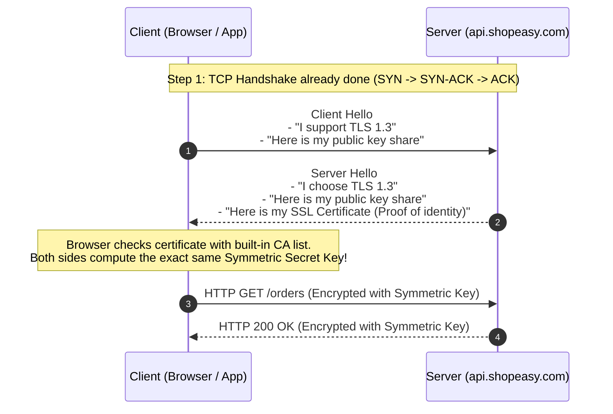
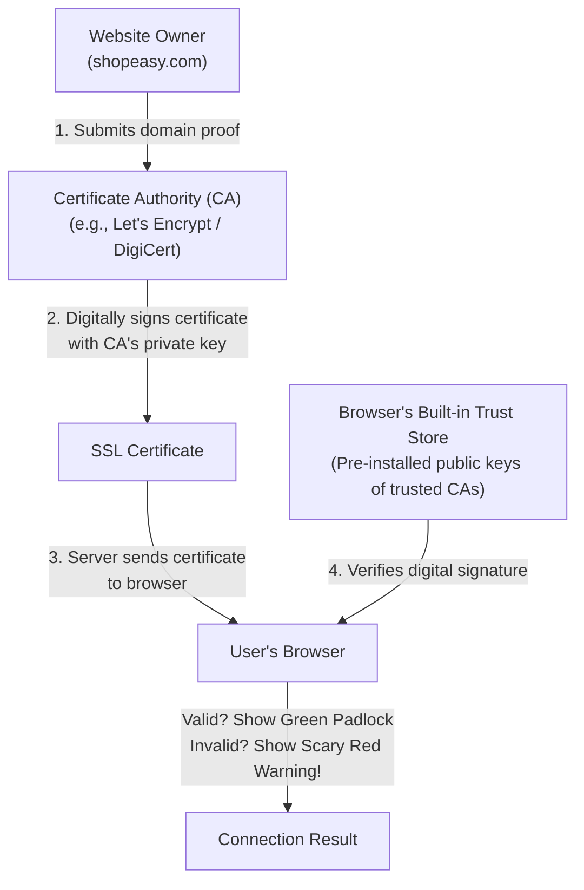
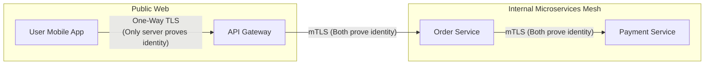
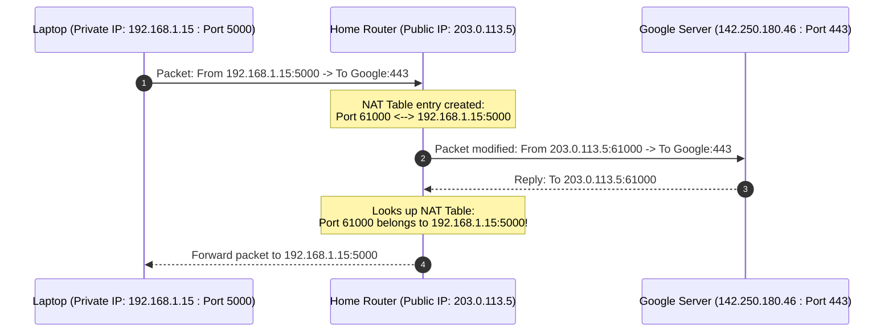
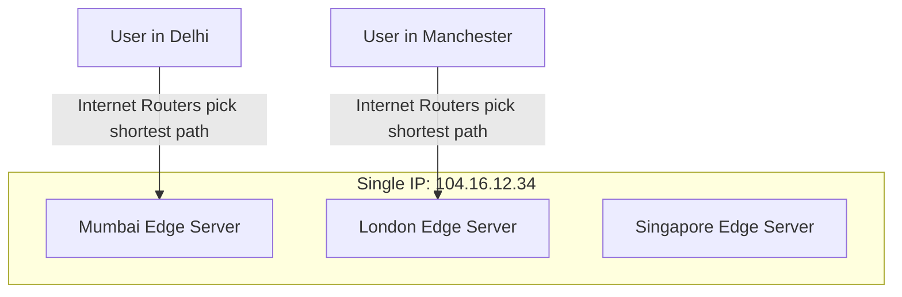
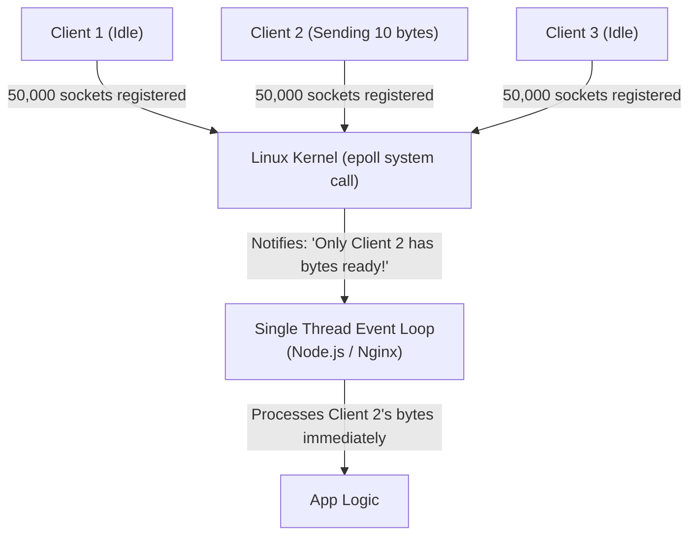
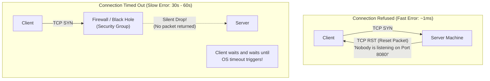
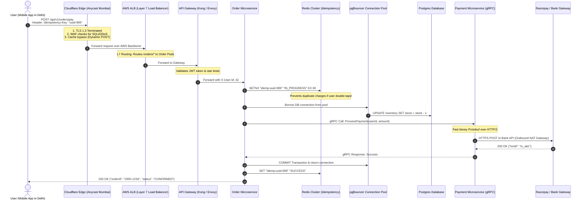

# Day 4 & 5 Combined Guide: Network Security, CDN, Sockets & Production Debugging

**For:** Backend developers with ~2 years experience preparing for ₹20+ LPA interviews.  
**Style:** Plain English, no textbook jargon, with visual diagrams for every concept.

---

## 🎯 What We Are Covering in this Guide

Instead of dry textbook definitions, this guide breaks down the practical network concepts interviewers test when assessing whether you can handle real production systems:

1. **How HTTPS & TLS Actually Work** (Encryption, Certificates, Handshakes & mTLS)
2. **NAT & IP Routing** (How private IPs talk to the open internet)
3. **CDNs & Anycast Routing** (How Cloudflare / CloudFront cut latency)
4. **Socket I/O Models** (Why Node.js/Nginx handle 50k connections with 1 thread)
5. **Production Debugging Playbook** ("Connection Refused" vs "Timed Out", latency spikes)
6. **The Big Picture: "User Clicks Pay Now" End-to-End Architecture Flow**

---

## 1. How HTTPS & TLS Actually Work

### The Big Problem Plain HTTP Has
When you send data over plain HTTP:
- Anyone between you and the server (your Wi-Fi router, your ISP, an attacker on public Wi-Fi) can **read** your passwords and tokens in plain text.
- Anyone can **change** the data in the middle without you knowing.
- You have **no proof** that you are talking to the real server (an attacker could pretend to be your bank).

HTTPS solves all three using **TLS (Transport Layer Security)**.

---

### Step 1: Symmetric vs. Asymmetric Encryption (The Simple Key Analogy)

| Type | How It Works | Real-Life Analogy | Good For | Problem |
|---|---|---|---|---|
| **Symmetric** | **One secret key** locks AND unlocks the data. | A standard house lock with duplicate keys. | Super fast! Can encrypt gigabytes of video or JSON in milliseconds. | How do you share the secret key with a stranger over the internet without someone stealing it on the way? |
| **Asymmetric** | **Two keys:** A **Public Key** (locks the box) and a **Private Key** (unlocks it). | A mailbox: Anyone can drop a letter through the slot (Public Key), but only the owner has the physical key to open it (Private Key). | Safe to share the Public Key with the entire world. | Very slow and CPU-heavy. Takes too much computer math for large data. |

> 💡 **The Clever Solution in HTTPS:**  
> Use **Asymmetric Encryption** for just 10 milliseconds to safely exchange a temporary **Symmetric Key**. Once both sides agree on the secret key, switch to **Symmetric Encryption** for all actual web traffic!

---

### Step 2: The TLS 1.3 Handshake (Visual Flow)

In modern TLS 1.3, setting up encryption takes just **1 round-trip (1-RTT)**:



---

### Step 3: How Does Your Browser Know a Certificate is Real?

If an attacker sits between you and Google, why can't they generate a fake certificate that says "I am google.com"?



1. **Certificate Authorities (CAs):** Companies like DigiCert, Let's Encrypt, or Google Trust Services.
2. Your operating system and browser come **pre-installed with a list of trusted Root CAs**.
3. When `shopeasy.com` sends its certificate, your browser checks the mathematical signature using the CA's pre-installed public key. If an attacker created a fake certificate, the signature won't match, and Chrome blocks the site with: `"Your connection is not private"`.

---

### Step 4: What is mTLS (Mutual TLS)?

- **Normal HTTPS (One-Way):** Only the *client* verifies the *server*. (You check that Google is Google. Google doesn't ask for your laptop's SSL certificate).
- **mTLS (Two-Way):** Both sides verify each other! The server presents a certificate, AND the client must present its own certificate.



**Where is mTLS used?**  
Inside Kubernetes clusters and microservices (using service meshes like **Istio** or **Linkerd**). Even if a hacker breaks into one container, they cannot intercept traffic between other services because every service rejects connections that lack a valid internal certificate. This is called **Zero-Trust Networking**.

---

### 🎙️ Spoken Interview Answer (45 Seconds)
> "HTTPS uses a hybrid approach: asymmetric encryption to safely exchange keys, and symmetric encryption for fast communication afterward. During the TLS 1.3 handshake, the server sends its digital certificate signed by a trusted Certificate Authority. The browser checks this signature against its pre-installed trust store to confirm the server's identity. Once identity is verified, both sides derive a shared symmetric key to encrypt all subsequent requests and responses. In internal microservices, we often take this further using mTLS, where both client and server present certificates to enforce Zero-Trust security."

---

## 2. NAT (Network Address Translation): How Your Laptop Talks to the World

### The Problem
- The world ran out of IPv4 addresses years ago.
- Your laptop has an IP like `192.168.1.15`.
- Your friend's laptop in another city also has `192.168.1.15`!
- If millions of laptops have the same IP, how does Google send packets back to *your* laptop and not your friend's?

### The Solution: NAT (The Apartment Mailroom Analogy)

Think of your home router like the **mailroom of a large apartment building**:
- Inside the building, everyone has a flat number: Flat 101, Flat 102 (`192.168.1.x`).
- The outside world only knows **one street address** for the entire building (`203.0.113.5` - your public IP).
- When you send a letter out, the mailroom stamps the building's address on it and writes down in a logbook: *"Flat 101 sent mail to Google on Port 54321."*
- When Google's reply arrives, the mailroom checks its logbook: *"Ah, replies on Port 54321 go to Flat 101!"*



---

### Cloud System Design: Why AWS VPCs Need a "NAT Gateway"

In AWS or GCP, you place your databases and backend microservices inside a **Private Subnet** (they have private IPs, no public internet access).

**The Question:** If your backend server has no public IP, how does it download security patches from GitHub or call the Razorpay payment API?  
**The Answer:** You route outgoing traffic through an **AWS NAT Gateway** located in a public subnet. It allows your backend to initiate connections *out* to the internet, but blocks anything on the internet from connecting *in*.

---

## 3. CDNs (Content Delivery Networks) & Anycast Routing

### Why Does Physical Distance Matter?
Light travels through fiber optic cables at roughly **200,000 km per second**.
- Distance from Bengaluru to Virginia, USA: ~14,000 km.
- One round-trip (RTT): $28,000 \text{ km} \div 200,000 \approx 140 \text{ ms}$ minimum, just for the physical wire!
- If your web page needs 3 network round-trips to connect, a user in India waits **450ms before receiving a single byte**.

```
Without CDN:
User in Mumbai ────────────────── 140ms wire delay ──────────────────► Server in USA (Virginia)

With CDN:
User in Mumbai ─── 8ms ───► CDN Edge Server in Mumbai ──► [Cached Content!]
```

---

### How Does a CDN Send You to the Closest Server? (Anycast DNS)

Normally, one IP address belongs to exactly one physical server.  
With **Anycast Routing**, the CDN gives the **exact same IP address** to hundreds of servers all over the world (Mumbai, London, Singapore, New York)!



The global internet routers (using BGP) automatically route your request to whichever server is **physically closest** on the network.

---

### CDN Caching: What to Cache vs. What NOT to Cache

| Resource Type | Example | Cache Rule | Why |
|---|---|---|---|
| **Static Assets** | Images, logos, CSS, JavaScript bundles | Cache for 30 days to 1 year (`max-age=31536000`) | They rarely change. If code updates, your build tool generates a new filename (`app.v2.js`). |
| **Public API Data** | Product catalog, weather info, top headlines | Cache for 30 to 60 seconds (`s-maxage=60`) | A 60-second cache shields your database from 95% of read queries during viral traffic spikes. |
| **Personal / Auth Data** | Shopping cart, user profile, account balance | **DO NOT CACHE** (`Cache-Control: no-store, private`) | If a CDN caches this, User A might see User B's cart! |

---

### The "Cache Stampede" Problem (Interview Favorite)
**Scenario:** A popular product's cache expires at 12:00:00. At that exact second, 50,000 users refresh the page.  
**What happens:** All 50,000 requests miss the cache and hit your primary database at the same time. The database crashes!  
**Solution (Probabilistic Early Expiration or Mutex Lock):** When the cache is about to expire, the CDN or backend lets **only one single worker** re-fetch the data while serving the slightly stale cached copy to all other users until the new data arrives.

---

## 4. Socket I/O Models: Why Node.js & Nginx Scale So Well

In interviews, you might be asked:  
*"How can a single-threaded Node.js server or Nginx worker handle 50,000 concurrent user connections without crashing?"*

Let's understand the two models simply.

---

### Model A: Thread-Per-Connection (The Old Apache Model)

```
Connection 1 ──► [ OS Thread 1 ] ──► Waiting for user to send data... (Sleeping)
Connection 2 ──► [ OS Thread 2 ] ──► Waiting for user to send data... (Sleeping)
Connection 3 ──► [ OS Thread 3 ] ──► Waiting for user to send data... (Sleeping)
```

- Each thread takes **1MB to 8MB of RAM**.
- 10,000 connections = 10,000 threads = **80 GB of RAM** just to keep idle connections open!
- The CPU burns all its time jumping between threads (**context switching**).

---

### Model B: Non-Blocking Event Loop (The Nginx / Node.js / Netty Model)

Instead of one worker waiting by each phone, imagine **one smart receptionist sitting in front of a switchboard**:



1. The application tells the Linux operating system: *"Here are 50,000 socket descriptors. Wake me up only when one of them actually receives data."*
2. Linux uses a high-performance system call called **`epoll`**.
3. The single worker thread sleeps until `epoll` signals that Client #2 just sent data.
4. The thread processes Client #2's data in 0.1ms, sends the response, and goes right back to waiting.
5. **Result:** Millions of idle connections consume virtually zero CPU!

---

## 5. Production Debugging Playbook: Network Failures

When a production system breaks, an SDE-2 must quickly identify if the failure is caused by the **network**, the **database**, or the **application code**.

### 1. "Connection Refused" vs. "Connection Timed Out" (Top Interview Question!)



| Error | What Happened Under the Hood | Root Cause in Production |
|---|---|---|
| **Connection Refused** | The packet reached the server, but the operating system sent back an immediate **TCP RST (Reset)** packet saying: *"No program is listening on this port."* | 1. Your backend app crashed / isn't running.<br/>2. You configured the wrong port (e.g., app is on 8080, request went to 8081). |
| **Connection Timed Out** | The client sent a TCP SYN packet, but **received absolute silence**. No response came back before the timer ran out. | 1. A firewall or AWS Security Group is blocking the port.<br/>2. Routing issue / wrong IP.<br/>3. The server machine is completely powered off or frozen. |

---

### 2. The Production Diagnostic Toolkit

```powershell
# 1. Is the machine alive at the network level? (ICMP check)
ping 10.0.1.25

# 2. Is the specific TCP port open and reachable?
curl -v telnet://10.0.1.25:5432
# or in PowerShell:
Test-NetConnection -ComputerName 10.0.1.25 -Port 5432

# 3. Where along the route are packets being dropped?
tracert 10.0.1.25

# 4. Measure exact timing breakdowns of an HTTP request:
curl -w "DNS: %{time_namelookup}s | Connect: %{time_connect}s | TLS: %{time_appconnect}s | FirstByte: %{time_starttransfer}s | Total: %{time_total}s\n" -o /dev/null -s https://api.shopeasy.com
```

> 💡 **Look at the `curl -w` output above!**  
> If `time_namelookup` is 500ms, your **DNS** is slow.  
> If `time_connect` is high, your **TCP network latency** is bad.  
> If `time_starttransfer` (TTFB) is high, your **backend code / database query** is slow!

---

## 6. The Big Picture: "User Clicks 'Pay Now'"

Let's tie every single concept from Days 1 through 5 together into one complete architecture diagram.

### What Happens When a User Clicks "Pay Now" on ShopEasy?



---

## 7. Final Interview Cheat Sheet: 8 Plain-English Q&A

#### Q1: In simple terms, how does HTTPS protect my password when I submit a form?
> "When you submit a form, your data is encrypted using a temporary symmetric key that only your browser and the server possess. Even though the packets travel through your Wi-Fi router, local ISP, and public network switches, all those intermediaries see is scrambled, unreadable binary data. Furthermore, before sending the password, your browser verified the website's SSL certificate against its pre-installed Certificate Authority list, ensuring you are sending your credentials to the real server, not an impostor."

#### Q2: What is the difference between a Connection Refused error and a Connection Timed Out error?
> "A **Connection Refused** error happens almost instantly because the target server received the request, but its operating system sent back a TCP RST packet indicating that no program is listening on that port—meaning your app crashed or is bound to the wrong port. A **Connection Timed Out** error takes 30 to 60 seconds because the client received no reply at all; packets were silently swallowed by a misconfigured firewall, an AWS Security Group, or a dead network route."

#### Q3: Why does Node.js or Nginx use an event loop instead of creating a new thread for every connection?
> "Creating a thread per connection consumes several megabytes of memory per user and causes the CPU to waste cycles on thread context switching. Under 50,000 connections, a thread-per-connection server runs out of RAM and crashes. The event-loop model registers all 50,000 connections with the Linux kernel using the `epoll` system call. A single thread remains idle until the operating system signals that a specific socket has data ready to read, allowing one worker thread to handle massive concurrent traffic with very low memory usage."

#### Q4: What is an Anycast IP and how do CDNs use it?
> "Normally, an IP address points to a single computer. With Anycast, multiple servers located in different cities worldwide are assigned the exact same IP address. When a user requests that IP, global internet routers automatically direct the packets along the shortest physical network path to the nearest edge server. This ensures a user in Mumbai reaches a Mumbai server, while a user in London reaches a London server, minimizing latency."

#### Q5: What is a NAT Gateway and why do we use it in cloud architectures?
> "A NAT (Network Address Translation) Gateway lets instances in a private cloud subnet—like our backend app servers and databases—connect outbound to the internet to download updates or make external API calls, while preventing unauthorized computers on the internet from initiating inbound connections directly to those private instances."

#### Q6: What is a Cache Stampede and how do you prevent it?
> "A cache stampede happens when a high-traffic cached item expires, and thousands of concurrent requests miss the cache at the exact same moment, all hitting the database at once and taking it down. We prevent this using mutex locking or probabilistic early expiration, where the system allows only one single background worker to query the database and update the cache while temporarily serving slightly stale data to other users."

#### Q7: What is Mutual TLS (mTLS) and where is it used?
> "Standard TLS only verifies the server's identity to the user. Mutual TLS (mTLS) requires both the client and the server to present and verify each other's digital certificates before establishing a connection. It is heavily used in microservice architectures and service meshes like Istio to enforce Zero-Trust security: even inside a private cluster, services will not accept traffic from any pod that lacks an authentic internal certificate."

#### Q8: If an API endpoint is suddenly taking 2 seconds instead of 50ms, how do you debug it?
> "I use `curl` with timing formatting flags (`curl -w`) to break down the request duration into DNS lookup, TCP connect, TLS handshake, and Time to First Byte (TTFB). If the connect time is high, the issue is network latency or packet loss. If the connect time is low (e.g., 5ms) but TTFB is 1.9 seconds, the network is fine—the bottleneck is inside the server, such as a slow database query, lock contention, or an unindexed query."

---

*Days 4 & 5 Combined Guide Complete! You now possess a solid, production-grade understanding of network security, edge routing, socket I/O, and troubleshooting.* 🚀
