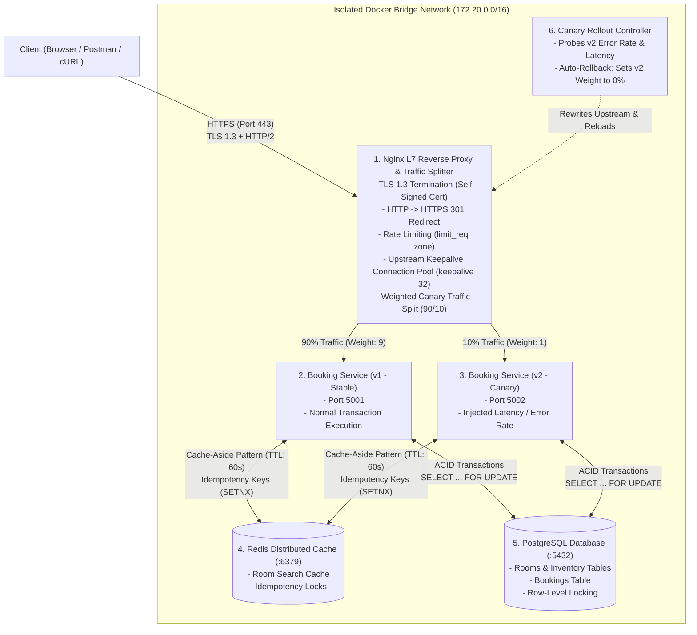

# Project Synopsis & Architecture Specification

## Project Title
**Production-Grade Distributed Booking Platform: High-Availability Microservices, Nginx L7 Traffic Management, PostgreSQL Concurrency Locking, Redis Caching & Automated Canary Rollbacks**

**Document Version:** 4.0.0  
**Target Roles:** Software Development Engineer (SDE / SDE-2) / Backend Systems Engineer  
**Architecture Focus:** Distributed Transactions, Concurrency Control, Edge Networking & Progressive Delivery  

---

## 1. Executive Summary

In modern enterprise architectures (e.g., Swiggy, Zomato, BookMyShow, Amazon), backend systems must balance two critical requirements:
1. **Application & Data Integrity:** Ensuring that concurrent operations (such as multiple users attempting to reserve the last inventory item) execute without double-booking anomalies or race conditions.
2. **Resilient Edge Traffic Management:** Ensuring that traffic enters through an optimized, secure gateway (Nginx) that terminates TLS, reuses upstream TCP connections, handles rate limiting, and supports progressive canary releases with automated rollback.

Rather than building a basic CRUD application from scratch, this project integrates an **open-source, production-ready transactional Booking/Reservation Service** (Python / FastAPI backed by PostgreSQL, e.g., `fastapi-booking`), and focuses engineering effort on designing and deploying the **production-grade networking, traffic management, and resilience layer** around it: an **Nginx Layer 7 Edge Reverse Proxy**, **Redis Distributed Caching & Idempotency**, and an **Autonomous Canary Rollout Controller**.

---

## 2. System Resource Allocation & Hardware Footprint

The entire multi-container mesh runs locally with minimal resource overhead:

| Component | Memory Allocation (RAM) | Architectural Characteristics |
|---|---|---|
| **Nginx (Edge Proxy & LB)** | **~10 MB RAM** | C-based event-driven I/O (`epoll`); handles TLS termination and connection pooling. |
| **PostgreSQL Database** | **~35 MB RAM** | ACID-compliant relational storage with row-level lock management. |
| **Redis Cache & Lock Store**| **~15 MB RAM** | In-memory key-value engine for query caching, rate limiting, and idempotency. |
| **Booking API (v1 - Stable)**| **~50 MB RAM** | Primary transactional service instance executing booking business logic. |
| **Booking API (v2 - Canary)**| **~50 MB RAM** | Canary release instance running simulated performance degradation. |
| **Rollout Controller Daemon**| **~10 MB RAM** | Lightweight health-monitoring script reconciling traffic weights. |

**Total Runtime Footprint:** **< 200 MB RAM** (Runs smoothly on any standard developer laptop).

---

## 3. High-Level Architecture Blueprint



---

## 4. Core Functional Modules

### Module 1: Upstream Workload — Open-Source Transactional Booking API & Database
- **Pre-Built Upstream API:** Leverages an open-source Python/FastAPI transactional booking microservice with PostgreSQL, providing pre-existing REST endpoints for inventory search (`GET /api/v1/rooms`) and reservation execution (`POST /api/v1/bookings`).
- **Concurrency Protection & Data Integrity:** Evaluates and hardens PostgreSQL **Row-Level Locking (`SELECT ... FOR UPDATE`)** inside database transactions. When 100 concurrent requests compete for the last available room, exactly 1 succeeds and 99 receive clean conflict responses (`409 Conflict`), eliminating overbooking anomalies under high network concurrency.

### Module 2: Network Idempotency & Duplicate Request Prevention
- **Idempotency Keys:** Enforces unique `Idempotency-Key` headers on `POST /bookings`.
- **Atomic Locking:** Uses Redis `SET key value NX EX 60` to store request status (`IN_PROGRESS`, `COMPLETED`). If a mobile client retries after a network timeout, the system returns the cached booking confirmation rather than double-charging or double-booking.

### Module 3: High-Speed Cache-Aside Engine (Redis)
- **Search Acceleration:** Implements cache-aside caching on `GET /rooms`. Uncached queries read from PostgreSQL and populate Redis with a 60-second TTL. Subsequent reads return from Redis in < 1ms, shielding PostgreSQL from read saturation during search spikes.

### Module 4: Nginx Edge Reverse Proxy & Connection Pooling
- **Upstream Connection Pooling:** Configures `keepalive 32;` with `proxy_http_version 1.1;` and cleared `Connection` headers to maintain persistent TCP sockets between Nginx and backend instances, eliminating repeated TCP 3-way handshake overhead.
- **Header Normalization:** Injects `X-Request-Id` for end-to-end distributed tracing and forwards client addresses via `X-Forwarded-For`.

### Module 5: TLS 1.3 Termination & HTTP/2 Multiplexing
- **TLS Offloading:** Terminates HTTPS on port 443 using an OpenSSL self-signed certificate, offloading asymmetric cryptographic overhead from backend runtimes.
- **Protocol Enforcement:** Redirects HTTP port 80 to HTTPS port 443 via `301 Moved Permanently`. Activates HTTP/2 binary stream multiplexing (`listen 443 ssl http2;`).

### Module 6: Traffic Regulation & Rate Limiting
- **Abuse Prevention:** Configures Nginx leaky bucket rate-limiting zones (`limit_req_zone $binary_remote_addr zone=api_limit:10m rate=10r/s;`).
- Bursts exceeding thresholds receive `HTTP 429 Too Many Requests` with appropriate retry guidance.

### Module 7: Weighted Canary Traffic Routing (90/10 Split)
- **Progressive Delivery:** Configures Nginx upstream blocks with weighted traffic distribution:
  ```nginx
  upstream booking_canary_cluster {
      server booking_v1:5001 weight=9;
      server booking_v2:5002 weight=1 max_fails=2 fail_timeout=10s;
      keepalive 32;
  }
  ```
- Exposes 10% of live traffic to the canary version (`v2`) while routing 90% to the verified baseline (`v1`).

### Module 8: Automated Rollout & Rollback Controller
- **Automated Health Monitoring:** A lightweight background controller monitors the canary instance (`v2`).
- **Autonomous Recovery:** If `v2` error rates exceed 5% or p99 latency spikes above 500ms, the controller automatically updates the Nginx upstream weight for `v2` to 0% and executes `nginx -s reload`, restoring 100% traffic to `v1` with zero user-facing downtime.

---

## 5. Non-Functional Requirements (NFRs)

| Metric | Target Specification |
|---|---|
| **Data Correctness** | 0% overbooking rate under 100 concurrent requests for a single inventory item |
| **Idempotency Guarantee** | 100% deduplication of re-submitted booking requests within a 60-second window |
| **Edge Routing Overhead** | $\le 5\text{ ms}$ proxy latency delta (`$request_time` - `$upstream_response_time`) |
| **Search Cache Latency** | $\le 2\text{ ms}$ response time for Redis cache hits |
| **Rollback Time** | $\le 10\text{ seconds}$ from anomaly detection to traffic re-route |

---

## 6. SDE-2 Interview & Resume Presentation

> **High-Availability Distributed Booking Platform (PostgreSQL, Redis, Nginx, Docker)**  
> *Architected a transactional reservation platform solving high-concurrency booking collisions via PostgreSQL row-level locks (`SELECT FOR UPDATE`) and Redis idempotency keys, eliminating overbooking anomalies under stress tests of 100 simultaneous requests. Designed an edge traffic layer using Nginx featuring TLS 1.3 termination, HTTP/2 multiplexing, upstream keepalive connection pooling, and Redis cache-aside acceleration. Engineered a weighted canary deployment pipeline (90/10 split) with an automated health controller that triggers instant traffic rollbacks upon detecting latency regressions.*
