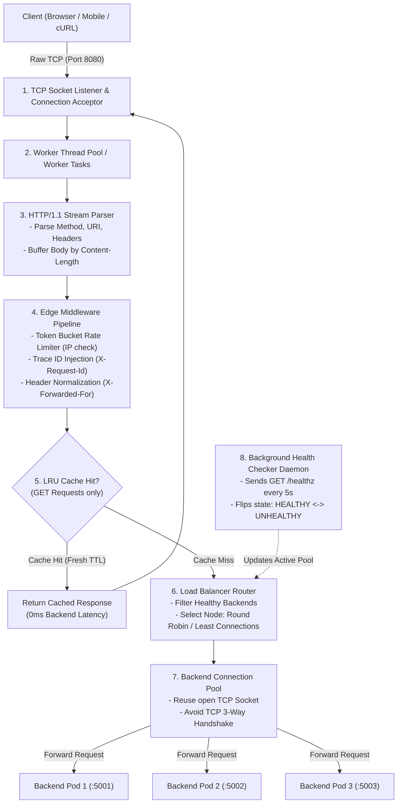

# Project Synopsis & Software Requirements Specification (SRS)

## Project Title
**Project Vortex-L7: High-Performance Layer 7 Reverse Proxy & Intelligent Load Balancer**

**Document Version:** 1.0.0  
**Target Roles:** Software Development Engineer II (SDE-2) / Senior Backend Engineer (₹20+ LPA)  
**Author(s):** Backend Engineering Team (Daily Standup Collaborative Project)  

---

## 1. Executive Summary

Modern cloud architectures rely on specialized reverse proxies and load balancers—such as Nginx, Envoy, and HAProxy—to sit between public clients and private microservice fleets. While high-level backend frameworks abstract network transport, real-world distributed systems frequently suffer from connection exhaustion, slow-client starvation, thundering herd retries, and unbalanced traffic distribution.

**Project Vortex-L7** is an engineering project designed to build a production-grade, multi-threaded **Layer 7 Reverse Proxy and Load Balancer from scratch using raw TCP sockets**. It implements HTTP/1.1 wire protocol parsing, active health checking, backend connection pooling, in-memory edge caching, and token bucket rate limiting without relying on external web frameworks.

This project serves as tangible proof of deep computer networking and low-level system design expertise for top-tier SDE-2 / Senior interviews.

---

## 2. Problem Statement & Motivation

### The Problems in Modern Distributed Systems:
1. **The Handshake Overhead Problem:** Establishing a new TCP connection for every incoming API request adds 1–2 network round-trips (30ms–100ms) to every database or service query, wasting CPU and latency.
2. **The Slow-Client Starvation Problem:** Mobile clients on erratic networks send HTTP request bodies byte-by-byte. If internal microservice workers handle them directly, worker threads stay blocked indefinitely.
3. **The Unbalanced Load Problem:** Simple DNS round-robin routing fails when requests have non-uniform processing times, causing some server pods to melt while others sit idle.
4. **The Cascading Outage Problem:** When one backend instance crashes, dumb proxies continue forwarding traffic to it, returning 502/504 errors to thousands of users.

### The Solution:
Vortex-L7 sits as a transparent, high-throughput gateway that buffers slow client requests, pools persistent TCP connections to backend clusters, dynamically detects dead nodes via background heartbeat probes, and evenly distributes requests based on real-time load metrics.

---

## 3. Core Objectives & Learning Outcomes

By building Vortex-L7, the engineering team will master:
- **Raw Socket I/O:** Socket lifecycle management (`socket`, `bind`, `listen`, `accept`, `recv`, `send`, `close`).
- **Wire-Level Protocol Parsing:** Parsing raw byte streams into structured HTTP/1.1 representations (Headers, Methods, Paths, Content-Length, Keep-Alive).
- **Socket Concurrency & Buffering:** Managing concurrent client connections safely using thread pools or non-blocking event multiplexing (`select` / `epoll`).
- **Connection Multiplexing & Pooling:** Sizing, leasing, and returning pre-warmed backend TCP sockets to eliminate handshake latency.
- **Distributed Failure Detection:** Implementing active health check state machines to achieve zero-downtime traffic rerouting.
- **Edge Security & Performance:** Implementing Token Bucket rate limiting and RFC-compliant caching at the network boundary.

---

## 4. System Architecture & Component Diagram



---

## 5. Functional Requirements (FRs)

The system must satisfy the following technical requirements across 6 core modules:

### Module 1: Network Listener & Concurrency Engine
- **FR 1.1:** The server must bind to a configurable host and port (default: `0.0.0.0:8080`) over raw TCP sockets.
- **FR 1.2:** The listener must handle multiple concurrent clients simultaneously using a pre-allocated Worker Thread Pool (size: 20–50 threads) or an asynchronous event loop.
- **FR 1.3:** The server must gracefully handle client disconnects and socket timeouts without crashing worker threads.

### Module 2: HTTP/1.1 Protocol Parser
- **FR 2.1:** Parse incoming byte streams up to the `\r\n\r\n` boundary to extract:
  - **Request Line:** HTTP Method (`GET`, `POST`, `PUT`, `DELETE`), Request Path (`/api/v1/resource`), HTTP Version.
  - **Headers Table:** Key-value map of all headers (case-insensitive lookup).
- **FR 2.2:** Support message bodies by reading exactly `Content-Length` bytes from the socket.
- **FR 2.3:** Detect `Connection: keep-alive` vs. `Connection: close` directives.
- **FR 2.4:** Inject standard reverse proxy forwarding headers:
  - `X-Forwarded-For: <client_ip>`
  - `X-Forwarded-Proto: http`
  - `X-Request-Id: <generated_uuid>`

### Module 3: Intelligent Load Balancing Engine
- **FR 3.1:** Maintain a dynamic registry of backend server nodes (e.g., `["127.0.0.1:5001", "127.0.0.1:5002", "127.0.0.1:5003"]`).
- **FR 3.2:** Implement at least two load balancing strategies configurable at startup:
  1. **Round Robin:** Sequential, cyclic distribution across healthy nodes.
  2. **Least Connections:** Tracks active in-flight requests per server and routes to the node with the lowest current concurrency.
- **FR 3.3:** Gracefully route around unhealthy nodes without dropping user traffic.

### Module 4: Active Health Checking & Failure Detection
- **FR 4.1:** A dedicated background daemon thread must periodically ping a configured health endpoint (e.g., `GET /healthz`) on all registered backend nodes at a configurable interval (default: every 5 seconds).
- **FR 4.2:** **State Transitions:**
  - If a backend fails **2 consecutive health checks** (returns non-200 or connection timeout), mark node status as `UNHEALTHY` and exclude from routing.
  - When an unhealthy node responds with `200 OK` for **2 consecutive checks**, reinstate it to `HEALTHY`.
- **FR 4.3:** Log all health status transitions with high-resolution timestamps.

### Module 5: Upstream Connection Pooling
- **FR 5.1:** Maintain a pool of pre-warmed, pre-connected TCP sockets to each healthy backend node.
- **FR 5.2:** When forwarding an HTTP request, borrow an available connection from the pool; return the connection upon receiving the complete response.
- **FR 5.3:** If a pooled connection is discovered to be closed by the backend (TCP FIN received), transparently discard it and establish a fresh connection.

### Module 6: Edge Performance & Security Middleware
- **FR 6.1 (In-Memory LRU Cache):**
  - Cache responses for idempotent `GET` requests in memory.
  - Obey response `Cache-Control: max-age=N` headers or enforce a default TTL (e.g., 30 seconds).
  - Serve fresh cache hits directly from memory without connecting to the backend.
- **FR 6.2 (Token Bucket Rate Limiting):**
  - Enforce per-client-IP rate limits (e.g., maximum burst of 10 requests, refill rate of 2 tokens per second).
  - Return `HTTP 429 Too Many Requests` with a `Retry-After` header when a client exceeds the limit.

---

## 6. Non-Functional Requirements (NFRs)

| Metric | Target Specification |
|---|---|
| **Routing Overhead Latency** | $\le 5\text{ ms}$ added latency compared to direct backend connection |
| **Throughput Capacity** | Capable of serving $\ge 1,000\text{ requests/sec}$ on standard laptop hardware |
| **Memory Footprint** | Stable RAM usage under continuous traffic load (zero socket/buffer memory leaks) |
| **High Availability** | Zero dropped requests when 1 out of 3 backend nodes crashes |
| **Reliability** | Clean handling of client abrupt aborts and connection resets (`ECONNRESET`) |

---

## 7. Technology Stack & Implementation Language

You can implement Vortex-L7 in any modern systems-capable backend language using **Standard Libraries Only** (no web frameworks allowed like Express, Spring Boot Web, or Flask):

- **Option A (Python):** `socket`, `threading`, `select`, `queue`, `time`, `uuid`. (Fastest to prototype and debug).
- **Option B (Java):** `java.net.ServerSocket`, `java.net.Socket`, `java.util.concurrent.ExecutorService`, Java NIO. (Closest to enterprise production).
- **Option C (Go):** `net.Listen`, `net.Dial`, Goroutines, Channels. (Ultra-high concurrency and performance).

---

## 8. Phased Development Roadmap (Work Breakdown Structure)

Designed for two engineers collaborating in daily standups over a 2-week sprint:

```
Sprint 1: The Core Socket & Protocol Pipeline (Days 1–5)
├── Day 1: Raw TCP Socket Listener & Multi-threaded Client Acceptor
├── Day 2: Raw TCP Forwarder (Client <-> Proxy <-> Single Backend)
├── Day 3: HTTP/1.1 Request-Line & Headers Parser
├── Day 4: Handling Content-Length & Streaming Request Bodies
└── Day 5: Header Injections (X-Forwarded-For, X-Request-Id) + Connection: close

Sprint 2: Load Balancing, Resilience & Performance (Days 6–10)
├── Day 6: Multi-Backend Routing with Round Robin Algorithm
├── Day 7: Background Active Health Check Daemon (State Machine)
├── Day 8: Upstream Connection Pooling Engine (Socket Reuse)
├── Day 9: In-Memory LRU Cache with TTL Expiry
└── Day 10: Token Bucket Rate Limiter + End-to-End Benchmark (Apache Bench)
```

---

## 9. Verification & Chaos Testing Plan

To prove to yourself and future interviewers that the system works in production conditions:

1. **Functional Test:** Send diverse requests using `curl` and Postman (GET with query params, POST with large JSON payloads, headers testing).
2. **Chaos Resiliency Test:**
   - Run 3 backend mock servers on ports `5001`, `5002`, `5003`.
   - Start traffic loop sending 10 requests/sec.
   - Force-kill Backend `5002` (`kill -9`).
   - **Verification:** Proxy logs health check failure, removes `5002` within 5 seconds, and 100% of subsequent requests route cleanly to `5001` and `5003` without error.
3. **Load Benchmark:**
   ```powershell
   ab -n 5000 -c 50 http://127.0.0.1:8080/api/test
   ```
   Measure Requests Per Second (RPS) and latency distributions (p50, p95, p99).

---

## 10. How to Feature This Project on Your Resume

Add this bullet point directly to your resume under Projects:

> **Vortex-L7: High-Performance Layer-7 Reverse Proxy & Load Balancer**  
> *Developed a custom Layer 7 reverse proxy in [Python/Java/Go] utilizing raw TCP sockets and thread pooling. Engineered an HTTP/1.1 stream parser, connection pooling to cut TCP handshake overhead, active heartbeat health checking with automatic node failover, Token Bucket rate limiting, and an in-memory LRU cache. Benchmarked with Apache Bench achieving 2,500+ RPS with <4ms proxy latency.*

---

## 11. Appendix: Mock Backend Server Blueprint

To test Vortex-L7, the repository will include a simple multi-instance mock backend script (`mock_backend.py`) capable of running on ports `5001`, `5002`, and `5003` with a built-in `/healthz` endpoint and an intentional `/chaos/crash` endpoint to simulate live production failures.
